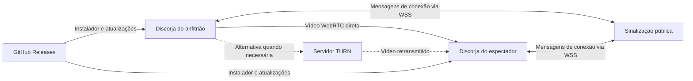

# Discorja

Compartilhe uma janela ou monitor com seus amigos em um aplicativo para **Windows 10/11 x64**. Uma pessoa cria a sala e transmite; as outras entram pelo código. A versão atual é **0.2.0**.

O aplicativo usa Electron, TypeScript e WebRTC. Oferece perfis até **1080p/60 FPS**, adaptação por espectador, diagnóstico da transmissão e atualização pelo GitHub Releases. Resolução e FPS são metas solicitadas: o resultado depende da fonte, dos computadores e da rede.

**Situação da distribuição:** este projeto ainda não tem sinalização pública hospedada, serviço TURN, certificado de assinatura ou releases publicadas. O instalador local de teste não tem assinatura e fica com as atualizações desativadas. A configuração desses recursos está explicada abaixo.

## Índice

- [O que o sistema faz](#o-que-o-sistema-faz)
- [Como os computadores se conectam](#como-os-computadores-se-conectam)
- [O que é necessário configurar](#o-que-é-necessário-configurar)
- [Executar localmente](#executar-localmente)
- [Usar o aplicativo](#usar-o-aplicativo)
- [Qualidade e limite de envio](#qualidade-e-limite-de-envio)
- [Colocar a sinalização na internet](#colocar-a-sinalização-na-internet)
- [Configurar STUN e TURN](#configurar-stun-e-turn)
- [Referência de configurações](#referência-de-configurações)
- [Preparar e enviar ao GitHub](#preparar-e-enviar-ao-github)
- [Instalador e atualizações](#instalador-e-atualizações)
- [Verificações antes de distribuir](#verificações-antes-de-distribuir)
- [Resolver problemas](#resolver-problemas)
- [Estrutura e comandos](#estrutura-e-comandos)
- [Limitações e documentação complementar](#limitações-e-documentação-complementar)

## O que o sistema faz

- Cria salas por convite, com código aleatório de oito caracteres.
- Permite escolher uma janela ou monitor, ver a prévia, iniciar e parar a captura.
- Aceita até quatro espectadores por sala por padrão; o anfitrião pode removê-los.
- Oferece 720p/30, 1080p/30 e 1080p/60, prioridade para detalhes ou movimento e limite total de envio.
- Mostra resolução, FPS, taxa de vídeo e outros dados disponíveis da conexão.
- Tenta recuperar interrupções da conexão de vídeo, com tentativas limitadas.
- Prepara instaladores Windows x64 e atualização com verificação de assinatura.

O MVP transmite **somente vídeo da tela**. Câmera, microfone, áudio do computador, chat, gravação, contas e múltiplos transmissores não estão implementados. O navegador mostra uma prévia da interface; o uso das salas exige o aplicativo desktop.

## Como os computadores se conectam



**Sinalização** organiza salas e troca as informações necessárias para conectar os participantes. Não recebe o vídeo. **STUN** ajuda o WebRTC a descobrir caminhos de rede. **TURN** pode retransmitir o vídeo quando a conexão direta não funciona. **GitHub Releases** distribui versões do aplicativo; não hospeda a sinalização e não transporta a transmissão.

O anfitrião envia uma cópia do vídeo para cada espectador. Mais espectadores aumentam o upload e o processamento do computador que transmite. O TURN mantém esse modelo de um envio por espectador.

## O que é necessário configurar

| Objetivo | Configuração necessária | Onde fazer |
| --- | --- | --- |
| Testar no próprio computador | Node.js, dependências e sinalização local | [Execução local](#executar-localmente) |
| Usar pela internet | Uma instância pública da sinalização com TLS/WSS e o mesmo endereço nos aplicativos | [Hospedagem](#colocar-a-sinalização-na-internet) |
| Conectar redes que impedem comunicação direta | Servidor TURN acessível e credenciais em cada cliente | [STUN/TURN](#configurar-stun-e-turn) |
| Distribuir instalador de teste | Gerar o pacote no Windows; atualizações ficam desativadas | [Instalador local](#instalador-local-para-testes) |
| Habilitar atualizações | Repositório público, assinatura Windows, três configurações do Actions e releases estáveis publicadas | [Atualizações](#habilitar-atualizações-pelo-github) |
| Confirmar a qualidade final | Medir recepção em computadores e redes reais, inclusive com vários espectadores | [Validação](#verificações-antes-de-distribuir) |

O TURN não é necessário para todo par de redes, mas precisa estar disponível e validado para atender os casos em que o caminho direto falhar. Não há garantia de 1080p/60 apenas por selecionar esse perfil.

## Executar localmente

### Requisitos

Para desenvolver e gerar o aplicativo, use Windows 10/11 x64, **Node.js 22.12 ou superior**, npm e acesso à internet para baixar dependências. O fluxo automatizado usa Node.js 22. Git é necessário para trabalhar com o repositório; Docker é opcional para hospedar a sinalização. Quem instala o `.exe` não precisa instalar Node.js, Git ou npm.

Os exemplos de terminal deste README usam **PowerShell**, na raiz do projeto. Substitua `SEU_USUARIO`, domínios e caminhos de exemplo pelos seus valores reais.

### 1. Preparar o código

Depois de criar e enviar seu repositório, uma nova máquina pode obtê-lo assim:

```powershell
git clone https://github.com/SEU_USUARIO/Discorja.git
Set-Location Discorja
npm ci
Copy-Item .env.example .env
```

Se já está na pasta do projeto, comece em `npm ci`. Copie `.env.example` somente se ainda não tiver um `.env`; preserve suas configurações locais. `npm ci` usa o `package-lock.json` e instala também o runtime Electron pelo script do projeto.

Para o primeiro teste, mantenha os valores locais do exemplo. Não é necessário configurar assinatura, GitHub ou TURN para transmitir entre duas instâncias no mesmo computador.

### 2. Iniciar a sinalização

No primeiro terminal:

```powershell
npm run server:dev
```

O processo escuta em `127.0.0.1:8787`. Confira em outro terminal:

```powershell
Invoke-RestMethod http://127.0.0.1:8787/health
```

A resposta deve conter `status: ok`. Isso comprova a disponibilidade do processo, ainda não o recebimento de vídeo.

### 3. Abrir o aplicativo

No segundo terminal:

```powershell
npm run dev
```

Esse comando abre o Electron e a interface de desenvolvimento na porta local 5173. Alterações no processo principal e no preload exigem reiniciar esse comando.

### 4. Abrir um espectador no mesmo computador

Com os dois processos anteriores abertos, use um terceiro terminal na raiz:

```powershell
$env:DISCORJA_DEV_URL = 'http://127.0.0.1:5173'
npx electron . --user-data-dir="$env:TEMP\discorja-espectador"
```

Crie a sala na primeira instância e entre na segunda pelo código. Compartilhe outra janela para evitar a imagem em espelho. Esse comando adicional não carrega `.env`; se mudou o servidor, configure o mesmo endereço na interface da segunda instância. Para testar TURN nela, defina também `DISCORJA_ICE_SERVERS` no ambiente antes de abri-la.

Os dados dessa instância ficam em uma pasta separada no diretório temporário do Windows. Encerre os aplicativos e os processos de desenvolvimento ao terminar.

## Usar o aplicativo

1. Instale e abra o Discorja em cada computador.
2. Abra **Configurações → Servidor de sinalização**, informe o mesmo endereço em todos e salve. Pela internet, será algo como `wss://sinal.seudominio.com`.
3. O anfitrião informa seu nome e cria a sala. Criar a sala não inicia a captura.
4. Escolha a qualidade, selecione uma janela ou monitor, confira a fonte e inicie a transmissão. A prévia e os indicadores mostram a captura ativa.
5. Compartilhe o código com os amigos. Eles informam nome e código para entrar.
6. Acompanhe espectadores e métricas. A qualidade pode ser alterada ao vivo.
7. **Parar a transmissão** encerra a captura e mantém a sala aberta. **Fechar a sala** desconecta todos e invalida o código. O espectador pode sair sem encerrar a sala dos demais.

Saia ou feche a sala antes de alterar o servidor ou reiniciar para atualizar. A sala expira em quatro horas por padrão. Perder o anfitrião ou reiniciar a sinalização também encerra a sala; nesse caso, crie outra e compartilhe o novo código.

Remover uma pessoa encerra a conexão atual, mas não impede que ela entre novamente com o código. Para revogar esse convite, feche a sala e crie outra. O nome exibido é informado pelo participante, sem verificação de identidade.

## Qualidade e limite de envio

| Perfil | Limite de captura solicitado | Teto inicial de vídeo por espectador | Uso sugerido |
| --- | --- | --- | --- |
| 720p / 30 FPS | Até 1280 × 720 e 30 FPS | 4 Mbps | Começar com menor carga |
| 1080p / 30 FPS | Até 1920 × 1080 e 30 FPS | 8 Mbps | Texto, código e apresentações |
| 1080p / 60 FPS | Até 1920 × 1080 e 60 FPS | 12 Mbps | Movimento com capacidade disponível |

O padrão é 720p/30, **Textos e detalhes**, **Ajustar à conexão** ligado e **40 Mbps de limite total de envio**. Esse limite aceita valores de 4 a 100 Mbps e é dividido entre as conexões ativas. Com quatro espectadores em 1080p/60 e limite de 40 Mbps, o teto inicial fica em até 10 Mbps por espectador. Cabeçalhos e retransmissões podem aumentar o consumo real além da taxa de vídeo.

Para testar 1080p/60, use uma fonte com tamanho suficiente e movimento a 60 FPS, selecione **Vídeos e jogos**, comece com um espectador e ajuste o limite abaixo do upload disponível, deixando folga. Confira a resolução e os FPS **recebidos** no espectador. A proporção da fonte é preservada: uma janela de 1920 × 1032 não se transforma em uma fonte nativa de 1920 × 1080.

**Textos e detalhes** favorece nitidez; **Vídeos e jogos** favorece fluidez. A adaptação observa problemas sustentados e ajusta cada envio, recuperando qualidade aos poucos. Uma tela parada pode gerar poucos quadros novos sem estar travando. Desligar a adaptação do app mantém o controle normal de congestionamento do WebRTC e não força a entrega de 60 FPS.

Mantenha a janela de origem produzindo conteúdo: minimizar o Discorja é diferente de minimizar a janela compartilhada. Se houver limitação de processamento ou rede, reduza o perfil ou o número de espectadores e compare as métricas. Veja a [análise completa de qualidade e otimização](docs/qualidade.md) e os [resultados medidos da versão 0.2.0](docs/validacao-0.2.0.md).

## Colocar a sinalização na internet

Todos precisam alcançar o **mesmo servidor público**. `127.0.0.1` significa o próprio computador de cada pessoa; enviá-lo aos amigos não os conecta ao seu servidor. Fora do próprio computador, inclusive em rede local, o aplicativo exige **WSS com certificado TLS válido**.

A hospedagem precisa manter um processo Node.js ou container e conexões WebSocket longas. Use **uma única instância** nesta versão: as salas ficam na memória e não são compartilhadas entre réplicas. Suspensão automática do host e reinícios encerram as salas.

### Exemplo com Docker e proxy TLS

Em um servidor com Docker e um proxy TLS instalado, a partir do código do projeto:

```powershell
docker build -t discorja-signaling .
docker run -d --name discorja-signaling --restart unless-stopped -p 127.0.0.1:8787:8787 -e ALLOWED_ORIGINS=app://discorja -e MAX_VIEWERS=4 -e ROOM_TTL_MS=14400000 discorja-signaling
```

O Dockerfile executa somente a sinalização Linux, com `HOST=0.0.0.0` dentro do container. A publicação em `127.0.0.1` restringe o acesso da porta 8787 ao próprio host, onde deve estar o proxy deste exemplo.

Para um Caddy no mesmo host, configure seu `Caddyfile`:

```caddyfile
sinal.seudominio.com {
    reverse_proxy 127.0.0.1:8787
}
```

Aponte o DNS do domínio para o servidor, permita acesso externo às portas 80/443 para esse exemplo e mantenha o armazenamento de certificados do Caddy persistente. Valide e recarregue a configuração do proxy conforme sua instalação. O Caddy pode gerenciar HTTPS quando esses requisitos estão atendidos; veja [HTTPS automático](https://caddyserver.com/docs/automatic-https) e [proxy reverso](https://caddyserver.com/docs/caddyfile/directives/reverse_proxy).

Valide o domínio:

```powershell
Invoke-RestMethod https://sinal.seudominio.com/health
```

Use `wss://sinal.seudominio.com` em **Configurações**, em todos os computadores. Os caminhos WebSocket aceitos pelo servidor são `/` e `/ws`; `/health` serve apenas para monitoramento.

Se a hospedagem já fornecer domínio, TLS e encaminhamento WebSocket, não é necessário adicionar Caddy: configure `HOST=0.0.0.0`, a porta exigida pelo provedor e as demais variáveis da tabela abaixo. O comando de produção, após `npm ci` e `npm run server:build`, é `npm run server:start`. Esse comando **não carrega `.env` automaticamente**; injete as variáveis pelo ambiente do serviço.

Operação, alternativa sem Docker, requisitos do proxy e monitoramento estão no [manual de implantação](docs/implantacao.md).

## Configurar STUN e TURN

Por padrão, o app usa `stun:stun.l.google.com:19302`, sujeito à disponibilidade desse serviço. STUN não substitui TURN quando a rede impede o caminho direto. Defina um serviço TURN próprio ou contratado para atender essas redes; ele não está incluído no Dockerfile da sinalização.

O provedor deve fornecer endereços, portas, usuário, credencial e validade. Configure **cada aplicativo**, anfitrião e espectadores, pelo ambiente que o inicia. Exemplo de estrutura, com valores fictícios:

```powershell
$env:DISCORJA_ICE_SERVERS = '[{"urls":"stun:turn.seudominio.com:3478"},{"urls":["turn:turn.seudominio.com:3478?transport=udp","turns:turn.seudominio.com:5349?transport=tcp"],"username":"USUARIO_TEMPORARIO","credential":"CREDENCIAL_TEMPORARIA"}]'
& 'C:\CAMINHO_REAL_DA_INSTALACAO\Discorja.exe'
```

Feche antes as instâncias antigas para que a nova execução leia o ambiente. Use o caminho real escolhido no instalador, consultável nas propriedades do atalho. Substitua os valores de exemplo antes de executar. No desenvolvimento, a variável pode ficar no `.env` local usado por `npm run dev`.

**O app instalado não lê um `.env` ao lado do executável e ainda não tem uma tela para configurar TURN.** ICE é lido ao iniciar. Não basta definir esses valores no servidor de sinalização nem nos Secrets do GitHub. O JSON substitui a lista inteira; inclua STUN junto de TURN se desejar ambos. `[]` desativa servidores STUN/TURN externos para testes isolados.

Use credenciais temporárias e renováveis, entregues por um canal privado. Este MVP não emite, distribui ou renova essas credenciais automaticamente; automatizar isso exige implementação adicional. Não coloque credenciais permanentes no código ou instalador. Confirme nas métricas o caminho de retransmissão `relay` antes de considerar TURN validado. Veja [STUN/TURN na implantação](docs/implantacao.md#stun-e-turn-nos-clientes).

## Referência de configurações

### Aplicativo desktop

| Nome | Padrão | Onde e quando configurar |
| --- | --- | --- |
| Servidor na interface | `ws://127.0.0.1:8787` na primeira abertura | Configurações; persiste no computador. Altere fora de uma sala. |
| `DISCORJA_SIGNALING_URL` | Sem sobreposição por ambiente | Ambiente ao iniciar; prevalece sobre o endereço salvo naquela abertura. Para servidores externos, use `wss://`. |
| `DISCORJA_ICE_SERVERS` | STUN público citado acima | Ambiente ao iniciar; array JSON `RTCIceServer[]`, até 8 entradas, cada uma com até 8 URLs `stun:`, `stuns:`, `turn:` ou `turns:`. |
| `DISCORJA_DEV_URL` | Não definido | Uso interno do desenvolvimento: somente `http://127.0.0.1:5173`. Não configure em produção. |
| Perfil, prioridade, adaptação, orçamento | 720p/30, detalhes, ligado, 40 Mbps | Controles da sala do anfitrião; salvos nas preferências locais. |

O endereço da sinalização fica em `settings.json` na pasta de dados do Electron, normalmente `%APPDATA%\Discorja` no Windows. Nome e preferências de qualidade ficam no armazenamento local da interface dessa instalação. Esses dados não são arquivos do repositório.

### Servidor de sinalização

| Variável | Padrão fora do container | Função |
| --- | --- | --- |
| `HOST` | `127.0.0.1` | Interface de escuta. Use `0.0.0.0` dentro de containers/plataformas que precisam expor o processo. |
| `PORT` | `8787` | Porta HTTP/WebSocket; em produção use a porta encaminhada pelo proxy/provedor. |
| `MAX_VIEWERS` | `4` | Máximo de espectadores por sala, sem contar o anfitrião. |
| `ROOM_TTL_MS` | `14400000` | Duração máxima da sala desde a criação: quatro horas, em milissegundos. |
| `MAX_ROOMS` | `1000` | Máximo de salas simultâneas no processo. |
| `MAX_CLIENTS` | `5000` | Máximo de conexões WebSocket no processo. |
| `ALLOWED_ORIGINS` | `app://discorja,http://127.0.0.1:5173,http://localhost:5173` | Origens separadas por vírgula. Para aplicativos instalados em produção use `app://discorja`. |

Limites de salas/clientes são proteções, não uma capacidade de hospedagem certificada. Aumentar `MAX_VIEWERS` não aumenta o upload do anfitrião. O servidor também limita tentativas e mensagens por conexão/IP; atrás de um proxy vários usuários compartilham esses limites. Veja o [manual de implantação](docs/implantacao.md).

### Quem lê o arquivo `.env`

| Execução | Carrega `.env` da raiz automaticamente? |
| --- | --- |
| `npm run dev` | Sim, para o aplicativo de desenvolvimento. |
| `npm run server:dev` | Sim, para a sinalização de desenvolvimento. |
| `npm start`, `npm run server:start` | Não; use o ambiente do processo. |
| `npm run build`, `npm run dist:win` | Não; as variáveis de release precisam estar no ambiente do build. |
| Aplicativo instalado / container | Não; cada um recebe seu próprio ambiente. |

Para iniciar explicitamente o servidor compilado com um arquivo local, use `node --env-file=.env dist/server/index.js`. Variáveis já definidas no ambiente prevalecem sobre o arquivo. Não envie `.env` ao GitHub. As variáveis de cliente não são incorporadas ao instalador por colocá-las no ambiente do build.

## Preparar e enviar ao GitHub

Crie um repositório **público e vazio**, sem README, licença ou `.gitignore` gerados pelo GitHub, para o primeiro envio deste projeto já existente. O fluxo atual publica o instalador **nesse mesmo repositório** e os clientes baixam sem token. Manter o código privado e usar outro repositório público de distribuição exige adaptar o fluxo; não está configurado.

Antes de adicionar arquivos, revise:

```powershell
git status --short
git add --dry-run .
```

Devem entrar código, testes, documentação, scripts, configurações compartilhadas, workflows, `.env.example`, os três ícones em `build/` e `package-lock.json`. O `.gitignore` exclui dependências, compilações, instaladores, relatórios, caches, arquivos locais e formatos comuns de certificados/chaves. Instaladores serão anexos de Releases, não arquivos do código-fonte.

O `.gitignore` não reconhece uma senha escrita em um arquivo permitido e não remove arquivos já rastreados. Confira a lista e não use `git add -f` para contornar exclusões. Certificados, `.env` e artefatos gerados devem ficar fora dos commits.

Depois de revisar, faça o primeiro envio, substituindo a URL:

```powershell
git add .
git diff --cached --stat
git commit -m "Adiciona Discorja e documentação"
git branch -M main
git remote add origin https://github.com/SEU_USUARIO/Discorja.git
git push -u origin main
```

O repositório local já está inicializado; não é necessário outro `git init`. Se já adicionou um remoto, confira `git remote -v` antes de executar `git remote add`. Em uma cópia já enviada, use o fluxo normal de commits, sem repetir a preparação inicial.

Na aba **Actions**, permita a execução dos workflows se estiver desabilitada e confirme a aprovação de **CI**. Ele verifica tipos, formatação, testes e build em Windows. Não publica versões nem recebe o certificado. Os testes de captura com desktop são executados separadamente.

## Instalador e atualizações

### Instalador local para testes

Em um terminal sem `GITHUB_REPOSITORY` e sem `DISCORJA_PUBLISHER_NAME` definidos:

```powershell
npm ci
npm run dist:win -- --publish never
```

Para a versão atual, o resultado é `release/Discorja-Setup-0.2.0.exe`. O comando não publica arquivos. Sem configuração de release ele não exige assinatura e deixa o atualizador desativado. Se houver credenciais de assinatura no ambiente, confira o resultado em vez de presumir o estado da assinatura.

As variáveis de distribuição devem ser configuradas em conjunto; definir somente parte delas causa erro. Para gerar apenas a pasta executável, use `npm run pack:win -- --publish never`. Não distribua só um arquivo retirado de `win-unpacked`; a pasta inteira é necessária para esse modo de teste.

### Habilitar atualizações pelo GitHub

1. **Prepare a assinatura Windows.** O workflow espera um certificado de assinatura de código com chave privada compatível com `CSC_LINK`, por exemplo um PFX/P12 protegido por senha e utilizável no runner. Certificado TLS do domínio não serve para assinar o instalador. Certificados com chave em hardware e serviços de assinatura remota exigem integração própria.
2. No repositório, abra **Settings → Secrets and variables → Actions**. Na aba **Variables**, crie a variável de repositório `DISCORJA_PUBLISHER_NAME` com o nome exato do publicador do certificado. Nas **Secrets**, crie `CSC_LINK` com o conteúdo do certificado em base64 e `CSC_KEY_PASSWORD` com sua senha. O [manual de releases](docs/releases.md) mostra como cadastrar esses valores sem imprimir o certificado.
3. **Permita Actions e escrita de Releases.** O job já declara `contents: write`; políticas da organização/repositório precisam permitir essa permissão. `GITHUB_REPOSITORY` e `secrets.GITHUB_TOKEN` são fornecidos pelo GitHub automaticamente. Não crie token para embutir no aplicativo.
4. **Prepare uma versão estável.** `package.json`, `package-lock.json` e tag devem concordar. Para a primeira publicação desta versão, envie primeiro o commit e depois execute `git tag v0.2.0` e `git push origin v0.2.0`, se essa tag ainda não existir. Nas próximas versões, use `npm version patch --no-git-tag-version`, revise e faça commit dos dois arquivos, crie a tag correspondente e envie commit/tag. Use `vMAJOR.MINOR.PATCH`, sem sufixo de pré-release.
5. **Acompanhe Actions → Release Windows.** O fluxo valida, assina o instalador, verifica Authenticode e prepara um **rascunho** de Release. Também pode ser iniciado por **Run workflow**, com uma tag que já exista no remoto e corresponda à versão do pacote.
6. **Revise e publique o rascunho.** O conjunto da mesma compilação precisa conter `.exe`, `.exe.blockmap` e `latest.yml`. Teste antes de publicar e mantenha a release estável, sem marcá-la como pré-release. Em rascunho, os clientes não encontram a atualização.
7. **Instale manualmente a primeira versão assinada.** Instaladores locais antigos têm o atualizador desativado e não se tornam atualizáveis apenas porque você configurou o GitHub. Feche o aplicativo e instale a primeira distribuição assinada por cima da versão de teste, validando o resultado.
8. **Valide com uma segunda versão maior.** Publique outra release assinada pelo publicador esperado e abra a anterior instalada. Confirme consulta, download, reinício e nova versão. Esse teste ainda precisa ser realizado com seu certificado e repositório reais.

O caminho padrão de publicação não exige editar o código. `scripts/prepare-release.mjs` gera `build/release.json` com repositório e publicador; o build inclui esses dados públicos no aplicativo. Certificado, senha e token ficam no ambiente de build, fora do instalador. Não edite nem versione esse arquivo gerado.

Na versão assinada/configurada, o app consulta atualizações cerca de cinco segundos após abrir, baixa uma versão nova automaticamente e oferece **Configurações → Reiniciar e instalar**. Também existe **Verificar atualizações**. A instalação depende dessa ação; saia da sala antes de reiniciar. O atualizador verifica integridade e assinatura do publicador e não aceita pré-releases neste fluxo.

Mantenha estáveis `appId`, repositório de distribuição e identidade do publicador. Trocas desses dados e do certificado precisam de planejamento e teste de migração. A atualização do **servidor** é separada: você precisa implantar sua nova imagem/processo, o que encerra as salas atuais.

O [manual de releases](docs/releases.md) detalha credenciais, comandos, validação, reexecução de rascunhos e diagnóstico.

## Verificações antes de distribuir

Na raiz, execute:

```powershell
npm run typecheck
npm run format:check
npm test
npm run build
```

Em uma sessão Windows com o desktop disponível, teste captura e vídeo real:

```powershell
npm run test:e2e
```

Depois de empacotar, teste também o executável sem instalar:

```powershell
npm run test:e2e -- --packaged
```

O roteiro inicia sinalização própria, abre até três instâncias Electron e captura somente uma janela de teste criada por ele. Os relatórios ficam em `test-results/smoke.json` e `test-results/smoke-packaged.json`, com imagens em `test-results/`. São locais e não sobem ao GitHub. `--packaged` usa o pacote existente em `release/win-unpacked`; gere-o novamente se alterou o aplicativo.

`npm run test:e2e -- --network-stress` tenta acrescentar emulação de rede; confira a perda efetivamente medida antes de afirmar que o vídeo enfrentou a condição solicitada.

Para concluir a preparação do seu ambiente:

- [ ] Publicar e monitorar a sinalização em WSS, com domínio/certificado válidos.
- [ ] Configurar o mesmo endpoint em todos os computadores.
- [ ] Configurar TURN nos clientes e confirmar tráfego por `relay` em uma rede que precise dele.
- [ ] Testar dois computadores em redes diferentes; depois repetir com quatro espectadores.
- [ ] Medir 1080p/60 sustentado no recebimento, com movimento, além de CPU, rede e comportamento do anfitrião minimizado.
- [ ] Testar parar/reiniciar captura, remover espectador, encerrar/expirar sala e queda/reinício da sinalização.
- [ ] Configurar assinatura e Actions, publicar a primeira release e instalar a versão assinada.
- [ ] Validar atualização completa entre duas versões instaladas.

A versão 0.2.0 tem um [registro de validação local](docs/validacao-0.2.0.md) com testes, amostras curtas e seus limites. Ele não substitui os itens externos desta lista.

## Resolver problemas

| Sintoma | O que verificar |
| --- | --- |
| Não cria ou não encontra a sala | Mesmo endereço em todos; `/health`; WSS; código correto, ainda válido e sala não cheia. |
| Alterei `.env`, mas o instalado não mudou | O instalado não carrega `.env`. Configure endpoint na interface e ICE no ambiente do executável. Reinicie o app. |
| `ws://192.168...` foi recusado | WS só é aceito em `localhost`/`127.0.0.1`. Use WSS com TLS válido entre computadores. |
| `/health` funciona, mas a sala não conecta | Encaminhamento WebSocket, caminho `/` ou `/ws`, `ALLOWED_ORIGINS`, limites e logs do proxy. |
| Entra na sala, mas não recebe vídeo | Captura iniciada, fonte disponível e caminho ICE; configure/teste TURN. Sinalização saudável não garante mídia. |
| Pede 1080p/60 e recebe menos | Tamanho/FPS da fonte, movimento real, orçamento por espectador, perda, RTT e processamento. Reduza carga para comparar. |
| Para ao minimizar a janela compartilhada | Sistema ou aplicativo de origem pode parar de produzir quadros. Mantenha essa fonte ativa; minimizar o Discorja é outro caso. |
| Erro de ICE ao iniciar | JSON, protocolos, limites da lista e credenciais de `DISCORJA_ICE_SERVERS`. |
| Porta 5173 ou 8787 ocupada | Feche o processo anterior. O app usa 5173 fixa no desenvolvimento; se mudar a porta da sinalização, atualize os clientes. |
| Atualizações desativadas | Desenvolvimento ou pacote sem configuração de release. Instale a distribuição assinada/configurada. |
| Não encontra versão nova | Release pública, publicada, estável e maior que a instalada, com os três artefatos do mesmo build. |
| Workflow de release falha | Secrets, Variable, assinatura confiável, publicador, versão/tag e permissão de escrita; veja a etapa que falhou. |

Veja também [implantação](docs/implantacao.md), [releases](docs/releases.md) e [arquitetura](docs/arquitetura.md).

## Estrutura e comandos

```text
.github/workflows/   Verificação de código e release Windows assinada
build/              Ícones necessários ao pacote; configuração de release gerada
docs/               Arquitetura, implantação, qualidade e distribuição
scripts/            Desenvolvimento, builds e testes de ponta a ponta
src/electron/       Janela, captura autorizada, preferências e atualizações
src/renderer/       Interface, WebRTC, adaptação e métricas
src/server/         Sinalização HTTP/WebSocket
src/shared/         Protocolo e perfis compartilhados
tests/              Testes de configuração, segurança, salas e qualidade
```

| Comando | Finalidade |
| --- | --- |
| `npm ci` | Instalar as dependências do lockfile. |
| `npm run dev` | Abrir o aplicativo em desenvolvimento; não inicia a sinalização. |
| `npm run server:dev` | Sinalização com recarga em desenvolvimento. |
| `npm run build` | Compilar aplicativo e servidor em `dist/`. |
| `npm start` | Abrir o Electron a partir do build existente. |
| `npm run server:build` | Compilar somente a sinalização e seus módulos compartilhados. |
| `npm run server:start` | Executar a sinalização compilada. |
| `npm run typecheck` / `npm test` | Verificar tipos / executar testes automatizados. |
| `npm run format:check` / `npm run format` | Verificar formatação / formatar arquivos. |
| `npm run dist:win -- --publish never` | Preparar configuração, compilar e gerar instalador sem publicar. |
| `npm run pack:win -- --publish never` | Gerar pasta executável Windows, sem instalador. |
| `npm run test:e2e` | Testar captura e WebRTC local com desktop disponível. |
| `npm run test:e2e -- --packaged` | Repetir cenários no pacote Windows existente. |

`dist/`, `release/`, `node_modules/` e relatórios são resultados locais reproduzíveis. O `package-lock.json`, os ícones, o script de instalação do Electron e os workflows são entradas essenciais e devem ser versionados.

## Limitações e documentação complementar

As salas existem apenas na memória da sinalização. Código e nome não autenticam identidade; remoção não é bloqueio permanente. Não há aprovação individual de entrada, senha extra, recuperação de sala, emissão automática de credenciais TURN ou servidor de mídia para grande público. A escolha da fonte é explícita e não há gravação automática; espectadores podem registrar conteúdo por ferramentas próprias.

O caminho de GPU/codec depende do hardware e do Chromium; codificação por hardware não é garantida. Conteúdo protegido e algumas janelas podem não permitir captura. Pacote e workflows atuais cobrem Windows x64; macOS, Linux e ARM64 exigem trabalho adicional.

| Documento | Conteúdo |
| --- | --- |
| [Arquitetura e privacidade](docs/arquitetura.md) | Componentes, ciclo das salas, dados locais e segurança. |
| [Implantação](docs/implantacao.md) | Sinalização, TLS, variáveis, TURN e operação. |
| [Qualidade e estabilidade](docs/qualidade.md) | Adaptação, orçamento, métricas, gargalos e alternativas futuras. |
| [Instaladores e releases](docs/releases.md) | Assinatura, configuração do GitHub, publicação e atualização. |
| [Validação da versão 0.2.0](docs/validacao-0.2.0.md) | Evidências medidas e pendências de validação externa. |

Nenhuma licença de reutilização foi escolhida no projeto. Defina esse arquivo conforme a forma como pretende distribuir o código.
