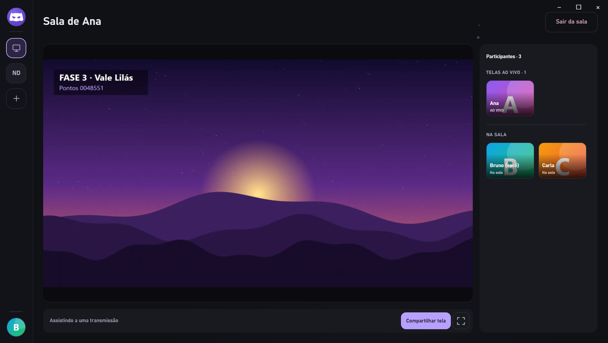
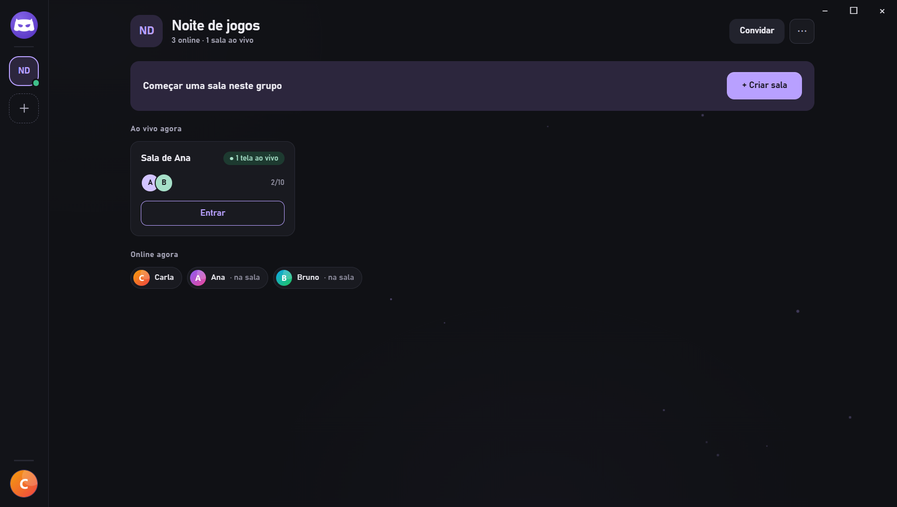
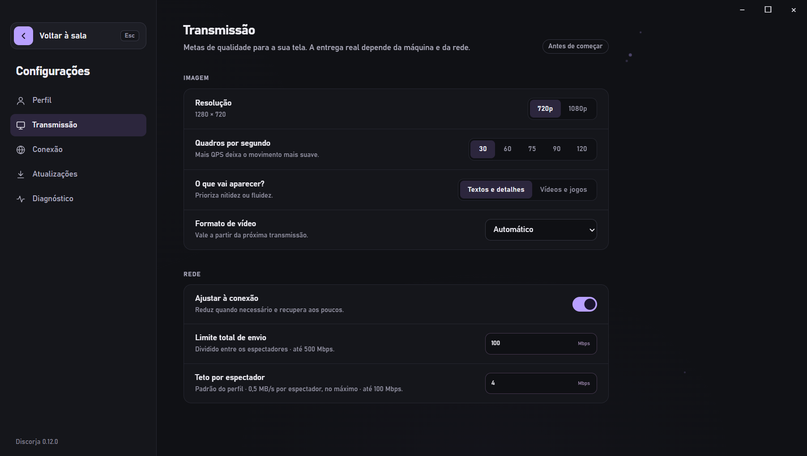
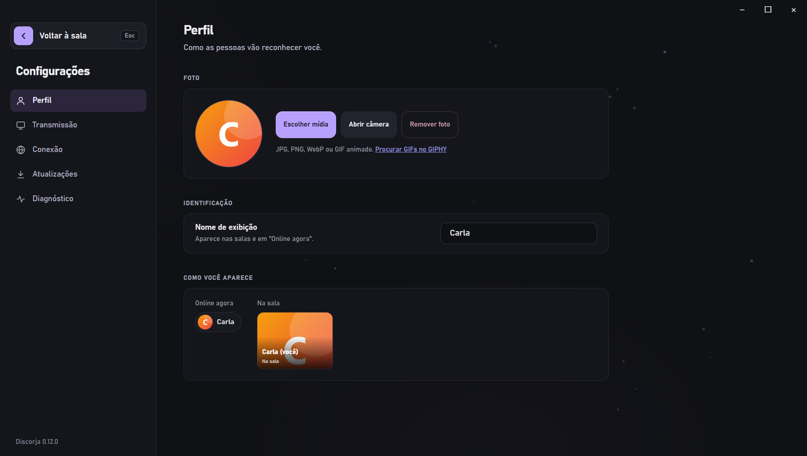

# Discorja

<p align="center">
  
</p>

<p align="center">
  Compartilhe a tela com seu grupo em salas privadas, com vídeo enviado diretamente entre os participantes.
</p>

<p align="center">
  <strong>Windows 10/11 · x64</strong> &nbsp;|&nbsp; Electron · TypeScript · WebRTC
</p>

<p align="center">
  <a href="#recursos">Recursos</a> ·
  <a href="#telas">Telas</a> ·
  <a href="#começar">Começar</a> ·
  <a href="#usar-com-amigos">Usar com amigos</a> ·
  <a href="#documentação">Documentação</a>
</p>

## Sobre

O Discorja é um aplicativo desktop para compartilhar uma janela ou monitor com amigos. Crie um grupo para a turma, mande o convite e entre nas salas do grupo com um clique — a conversa por voz continua no Discord; o Discorja cuida da tela.

A sinalização coordena grupos, salas e conexões, mas não recebe o vídeo. O áudio e o vídeo são enviados por WebRTC diretamente entre os participantes; redes que bloqueiam uma conexão direta podem exigir um servidor TURN.

## Recursos

- **Grupos por convite:** crie um grupo, copie o convite e veja no Início as salas ao vivo e quem está **online agora**, inclusive quem já está numa sala.
- **Salas com um clique:** até **10 participantes** por sala por padrão, sem digitar código.
- **Várias telas ao mesmo tempo:** todos podem transmitir; cada pessoa escolhe uma transmissão para assistir por vez.
- **Janela ou tela inteira**, com prévia e controles para iniciar e parar.
- **Qualidade ajustável:** resolução **720p** ou **1080p**, **30, 60, 75, 90 ou 120 QPS** e modo "Textos e detalhes" ou "Vídeos e jogos", com adaptação automática à conexão. São metas: a entrega real depende da captura, do computador e da rede.
- **Áudio do computador** opcional, com volume da transmissão e opção de excluir o áudio do Discord (depende do Windows e do aplicativo instalado).
- **Perfil com foto:** JPG, PNG, WebP ou GIF animado, ou uma foto tirada na hora pela câmera, exibida em "Online agora" e nos cartões da sala.
- **Configurações em seções** (Perfil, Transmissão, Conexão, Atualizações e Diagnóstico), diagnóstico exportável e registros locais de erro.
- **Atualizações pelo GitHub Releases** e "Novidades do Discorja" a cada versão.

As transmissões usam conexão ponto a ponto. Se várias pessoas assistirem à mesma tela, o computador que transmite envia uma cópia para cada espectador; o upload disponível e a capacidade de codificação podem reduzir a qualidade real.

O Discorja não captura microfone e não grava transmissões. A câmera só é usada quando você clica em **Abrir câmera** para tirar a foto de perfil; ela nunca é transmitida.

## Telas

<p align="center">
  <a href="docs/screenshots/sala.png"></a>
</p>
<p align="center"><sub>Sala com uma tela ao vivo</sub></p>

<p align="center">
  <a href="docs/screenshots/inicio.png"></a>
  <a href="docs/screenshots/configuracoes.png"></a>
  <a href="docs/screenshots/perfil.png"></a>
</p>
<p align="center"><sub>Início do grupo · Transmissão · Perfil</sub></p>

## Começar

### Requisitos para desenvolvimento

- Windows 10/11 x64.
- Node.js **22.12 ou superior** e npm.
- Visual Studio Build Tools com **Desenvolvimento para desktop com C++** somente para compilar o filtro nativo de áudio ou criar o instalador para Windows.

O instalador pronto não exige Node.js, npm ou Visual Studio Build Tools.

### Executar localmente

Na pasta do projeto, instale as dependências:

```powershell
npm ci
```

Copie o exemplo de configuração local:

```powershell
Copy-Item .env.example .env
```

Abra dois terminais na pasta do projeto. No primeiro, inicie o servidor de sinalização local:

```powershell
npm run server:dev
```

No segundo, inicie o aplicativo:

```powershell
npm run dev
```

O endereço local padrão é `ws://127.0.0.1:8787`. Para testar a exclusão do áudio do Discord durante o desenvolvimento, compile o componente nativo uma vez:

```powershell
npm run audio:build
```

### Usar com amigos

Para computadores diferentes, todos precisam apontar para o mesmo servidor de sinalização público, acessível por **WSS**. O servidor local em `127.0.0.1` serve apenas para testes no próprio computador.

Um jeito sem custo é publicar o servidor no plano gratuito do [Render](https://render.com/):

1. Faça um fork deste repositório.
2. No Render, crie um **Web Service** a partir do fork, com runtime **Docker** (o `Dockerfile` da raiz já gera só o servidor) e plano **Free**.
3. Em **Environment**, defina `ALLOWED_ORIGINS=app://discorja` e `TRUST_PROXY_HOPS=1`. Opcionalmente, configure o health check em `/health`.
4. Depois do deploy, copie o endereço do serviço trocando `https://` por `wss://` (por exemplo, `wss://meu-discorja.onrender.com`).
5. Cada participante informa esse endereço em **Configurações → Conexão → Servidor de sinalização**, usa **Testar conexão** e salva.

No plano gratuito, o serviço dorme após um período sem uso. Ao abrir o app, o Início mostra "Acordando o servidor…" e conecta sozinho quando ele responder, o que pode levar cerca de um minuto. Reiniciar ou reimplantar o serviço encerra as salas abertas.

O GitHub Releases distribui o instalador, mas não mantém o servidor de sinalização online. Veja [Implantação](docs/implantacao.md) para outras formas de hospedar, variáveis e STUN/TURN, e [Instaladores e atualizações](docs/releases.md) para configurar a distribuição do app.

## Comandos úteis

| Comando              | Ação                                                             |
| -------------------- | ---------------------------------------------------------------- |
| `npm run dev`        | Inicia o aplicativo em desenvolvimento.                          |
| `npm run server:dev` | Inicia a sinalização local.                                      |
| `npm run build`      | Gera o build do aplicativo e do servidor.                        |
| `npm run typecheck`  | Verifica os tipos TypeScript.                                    |
| `npm test`           | Executa os testes automatizados.                                 |
| `npm run dist:win`   | Gera o instalador Windows; requer o ambiente C++ descrito acima. |

## Documentação

- [Guia de desenvolvimento](docs/desenvolvimento.md) — ambiente, configurações, testes, empacotamento e validações antes de distribuir.
- [Salas e permissões](docs/salas.md) — convites, participantes, transmissões simultâneas e moderação.
- [Qualidade e estabilidade](docs/qualidade.md) — perfis, bitrate, adaptação e limites de desempenho.
- [Áudio](docs/audio.md) — áudio do sistema, exclusão do Discord e requisitos.
- [Implantação](docs/implantacao.md) — servidor público, WSS, variáveis de ambiente e STUN/TURN.
- [Instaladores e atualizações](docs/releases.md) — GitHub Releases, atualização automática e assinatura opcional.
- [Segurança](docs/seguranca.md) — proteção do aplicativo, servidor e dados.
- [Arquitetura e privacidade](docs/arquitetura.md) — componentes e fluxo de mídia.
- [Logs de erros](docs/logs.md) — exportação e conteúdo dos registros locais.
- [Plano de atualizações](docs/plano-de-atualizacoes.md) — etapas planejadas para o produto.

## Licença

O projeto ainda não possui uma licença de uso definida.
