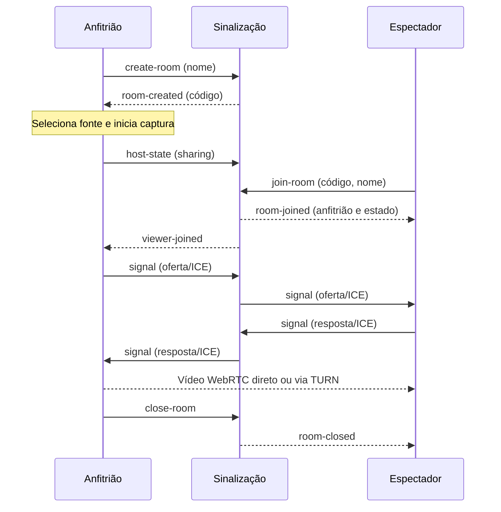

# Arquitetura e privacidade

## Consolidação na 0.8.0

O protocolo de salas permanece 3. A interface preserva foco, seleção de texto e menus abertos usando identificadores estáveis de ação/participante/publicação; a remoção do controle leva o foco a um ponto visível da sala. Diálogos limitam Tab aos controles visíveis e habilitados, incluindo selects. Um anunciador persistente informa mudanças de estado sem repetir a mesma mensagem a cada renderização.

O diagnóstico exportado usa `schemaVersion: 2`: preferências e métricas permitidas, estado resumido da sessão e runtime fornecido pelo processo principal. Versões do Electron/Chromium/Node, arquitetura, estado do updater e memória do renderer podem aparecer; nomes, convites, tokens, endpoint, SDP, ICE e conteúdo da tela continuam fora do relatório. O renderer não escolhe os valores de runtime. `ageMs` identifica a idade da amostra exportada; medições antigas são descartadas.

O teto opcional `videoBitrateMbps` é validado de 1 a 30 e aplica um limite por espectador ao controlador de envio. Sua ausência preserva o bitrate padrão do perfil. O orçamento total e a adaptação continuam limitando o alvo; não há configuração de bitrate mínimo ou preenchimento artificial para forçar tráfego.

## Publicação e seleção na versão 0.7.0

O protocolo 3 usa `publish-state` para a captura própria e `watch-publication` para a única tela escolhida. `stream-signal` identifica a publicação e o peer. O servidor só encaminha SDP/ICE entre o dono da publicação e seu assinante atual, na mesma sala. Respostas da seleção têm `watchRequestId`; o aplicativo aguarda essa confirmação antes de aceitar ofertas para a nova recepção. Ao repetir uma seleção para tentar novamente, o publicador substitui sua conexão anterior.

Os snapshots incluem publicações, limite, seleção atual e assinantes da própria publicação. Cada cliente recebe apenas seu token de retomada. O renderer mantém controladores WebRTC separados para envio e recepção: dois publicadores podem assistir um ao outro sem confundir os peers. Os cartões de `stage.ts` não criam recepções; trocar de destaque descarta a anterior.

`preview.ts` pausa e desconecta apenas o player local quando o processo principal informa perda de foco, minimização ou ocultação. Esse evento nativo continua disponível mesmo com os temporizadores da captura ativos em segundo plano. A ponte fornece somente um booleano, sem expor janela ou APIs genéricas do sistema. A captura não é clonada, interrompida ou reconfigurada para essa economia.

A sinalização permanece sem mídia e sem SFU. Papéis administrativos não determinam quem pode capturar no protocolo 3: cada pessoa publica sua tela dentro do limite, com autorização local explícita. Detalhes de migração em [salas.md](salas.md). A seção seguinte descreve o protocolo anterior.

## Salas na versão 0.5.0

O protocolo 2 confirma compatibilidade por `hello` e mantém dono e moderadores separados do transmissor autorizado. O servidor envia snapshots `room-state` com os participantes, o dono, o transmissor e o estado da publicação; cada conexão recebe somente seu próprio token. `set-publisher` e `set-moderator` são operações restritas e validadas no backend. Uma pessoa transmite por sala; receber permissão não inicia captura.

O dono sair encerra a sala, mesmo quando outro membro está transmitindo. A saída do transmissor devolve a permissão ao dono sem iniciar mídia. Os nomes `host` e `viewer` ainda usados pelo transporte representam emissor e receptor; não definem autoridade administrativa no protocolo 2. O contrato anterior permanece disponível em salas separadas para a transição dos clientes 0.3/0.4.

O serviço mantém várias salas independentes ativas ao mesmo tempo, permitindo que grupos diferentes se reúnam separadamente. Cada cliente participa de uma sala por vez. O início concentra a criação e a entrada por código; o controle de saída encerra tracks, peers e socket da sala atual e retorna ao início. Convites recentes não são persistidos. Se o cliente tentar iniciar outra conexão antes de sair, o aplicativo pede confirmação antes de encerrar sua sessão atual. Política, permissões e migração em [salas.md](salas.md).

O Discorja separa três funções:

| Componente                     | Responsabilidade                                                                                        |
| ------------------------------ | ------------------------------------------------------------------------------------------------------- |
| Processo principal do Electron | Janela do aplicativo, captura autorizada, configurações locais e atualizações.                          |
| Interface                      | Criar/entrar em salas, seleção e prévia da captura, controles e conexões WebRTC.                        |
| Sinalização WebSocket          | Criar e expirar salas, controlar participantes e encaminhar negociações entre anfitrião e espectadores. |

O processo principal usa isolamento de contexto e uma ponte de preload com operações específicas. A interface não recebe acesso genérico ao Node.js ou ao sistema de arquivos. A origem de produção do aplicativo é `app://discorja`.

## Organização do código

| Caminho                                       | Papel                                                                                               |
| --------------------------------------------- | --------------------------------------------------------------------------------------------------- |
| `src/electron/main.ts`                        | Cria a janela, autoriza captura, lê/salva endpoint, protege IPC e integra o atualizador.            |
| `src/electron/preload.ts`                     | Expõe apenas as operações tipadas de `DiscorjaAPI` à interface.                                     |
| `src/electron/config.ts`                      | Valida endpoint e lista de servidores ICE do cliente.                                               |
| `src/renderer/app.ts`                         | Coordena estado da janela, eventos e serviços de sala/captura.                                      |
| `src/renderer/views/`                         | Templates puros de início, qualidade, diagnóstico, navegação, configurações, sala, áudio e modais.  |
| `src/renderer/ui/`                            | Eventos, acessibilidade, previews, efeitos, helpers HTML e ícones da interface.                     |
| `src/renderer/media/`                         | WebRTC, captura de áudio, adaptação de qualidade e telemetria por peer.                              |
| `src/renderer/transport/`                     | Conexão WebSocket de sinalização e validação das respostas.                                         |
| `src/renderer/state/`                         | Persistência local de preferências, nome e qualidade.                                               |
| `src/renderer/styles/`                        | CSS base e estilos do app, agregados na ordem de cascata definida em `app.css`.                     |
| `src/renderer/features/capture/`              | Seleção, preparação, ativação e publicação da captura, áudio filtrado e ciclo das faixas.           |
| `src/renderer/features/quality/`              | Leitura de controles, aplicação/rollback e atualização visual das métricas.                         |
| `src/renderer/features/session/`              | Conexão, snapshots, mensagens, peers WebRTC, membros, recepção de publicações, áudio e recuperação. |
| `src/renderer/features/settings/`             | Operações de configuração iniciadas pela interface.                                                 |
| `src/renderer/features/diagnostics/`          | Exportação de relatórios de diagnóstico e logs locais.                                              |
| `src/renderer/features/updates/`              | Comandos de download, verificação e instalação de atualizações.                                     |
| `src/server/index.ts`                         | Entrada do serviço: variáveis de ambiente, porta e encerramento.                                    |
| `src/server/config.ts`                        | Valores padrão e validação das opções de execução e limites.                                        |
| `src/server/server.ts`                        | Ciclo HTTP/WebSocket, estado das salas, permissões e encaminhamento.                                |
| `src/server/message-validation.ts`            | Valida e normaliza mensagens WebSocket recebidas antes do processamento.                            |
| `src/shared/`                                 | Contratos, validação de snapshots, qualidade, logs e diagnósticos comuns.                           |

O fluxo de dependências é unidirecional: `shared` não depende das camadas do app; renderer e server podem usar `shared`; somente `main` chama operações privilegiadas do sistema e as expõe pelo preload. O servidor não importa a interface nem o Electron. Seu build pode rodar como processo Node.js ou container Linux. O pacote desktop inclui o processo principal e a interface, sem iniciar um servidor de sinalização embutido.

Para uma mudança nova, coloque markup puro em `renderer/views/`, persistência em `preference-store.ts`, comportamento de interface reutilizável em `ui/` e lógica de produto em `features/<domínio>/`. Deixe `app.ts` coordenar o estado compartilhado e conectar os módulos por interfaces estreitas; evite importar estado da aplicação de dentro de uma feature. Valide mensagens externas em `shared/validation.ts` ou `server/message-validation.ts`. O CSS base está em `style.css`; `app.css` é o ponto de entrada dos estilos de produto e importa arquivos por área em ordem de cascata. Preserve a sequência declarada nesse agregador quando mover regras entre arquivos.

## Ciclo de uma transmissão

1. O anfitrião abre uma conexão com a sinalização e cria uma sala com código aleatório de oito caracteres.
2. O anfitrião escolhe a fonte e inicia a captura. A interface mostra a prévia e o estado da transmissão.
3. Cada espectador entra pelo código. A sinalização encaminha ofertas, respostas e candidatos ICE entre os participantes autorizados.
4. O WebRTC estabelece uma conexão do anfitrião com cada espectador. O vídeo trafega diretamente ou por um TURN configurado nos clientes.
5. Parar a transmissão encerra a captura; fechar a sala invalida o convite e desconecta os espectadores. A sala também termina ao expirar ou perder o anfitrião.

As conexões de mídia WebRTC são criptografadas em trânsito. O serviço de sinalização ainda precisa ser confiável: ele conhece participantes e dados de negociação e controla o encaminhamento dessas mensagens. WSS protege a conexão entre cliente e servidor; não oferece autenticação de identidade dos amigos.

O código nasce na criação e expira a partir desse momento, mesmo sem captura. Parar vídeo muda o estado de compartilhamento; não altera o código nem prolonga a validade. Cada participante pertence a uma sala por conexão e recebe um identificador aleatório de sessão.

### Contrato de sinalização

As mensagens são JSON em WebSocket. O contrato tipado está em `src/shared/protocol.ts`; mudanças nele precisam permanecer compatíveis entre desktop e servidor.

| Mensagem do cliente         | Responsabilidade                                                                   |
| --------------------------- | ---------------------------------------------------------------------------------- |
| `create-room` / `join-room` | Criar ou entrar com nome; entrada também informa código.                           |
| `signal`                    | Encaminhar oferta, resposta ou candidato ICE ao `peerId` autorizado na mesma sala. |
| `host-state`                | Anfitrião informa se está compartilhando.                                          |
| `kick`                      | Anfitrião remove a conexão do espectador indicado.                                 |
| `close-room`                | Anfitrião encerra a sala.                                                          |
| `leave-room`                | Participante sai; se for anfitrião, a sala termina.                                |

O contrato da tabela corresponde ao protocolo anterior, mantido para transição. No protocolo 2, criação, entrada, retomada e alterações de participantes retornam `room-state`; a negociação de mídia continua em `signal`. As razões de encerramento são `host-left`, `host-closed` e `expired` (os nomes históricos referem-se à saída ou encerramento pelo dono). HTTP expõe `/health` e `/api/stats` quando habilitada por credencial, além do upgrade WebSocket em `/` e `/ws`; não há API HTTP pública de gestão das salas.

O servidor verifica formato, tamanho, campos permitidos e autorização para encaminhar cada sinal. Não permite comunicação arbitrária entre salas ou entre espectadores. Essas verificações não autenticam a identidade informada no campo nome.

## Qualidade e recuperação

O anfitrião obtém uma captura de vídeo e a envia por uma `RTCPeerConnection` para cada espectador. Os perfis 720p/30, 1080p/30 e 1080p/60 definem limites de captura e de codificação. O orçamento total de vídeo é dividido entre os envios, e cada conexão mantém sua própria adaptação. Uma conexão com problemas não reduz, por esse motivo isolado, a captura compartilhada pelos demais.

O cliente coleta estatísticas de envio e recepção e usa observações sustentadas para reduzir ou recuperar a qualidade com intervalo entre mudanças. A interface preserva o elemento de vídeo ao atualizar o estado. A renegociação ICE tem tentativas limitadas; falha da sinalização ou encerramento da sala exige uma nova entrada, sem restaurar automaticamente um convite invalidado.

Durante a captura, o aplicativo reduz a limitação de atividade em segundo plano no anfitrião. Isso evita depender dos timers normais de uma janela inativa; a taxa de atualização da fonte ainda depende do sistema e do aplicativo capturado.

O servidor continua encaminhando somente sinalização. TURN pode retransmitir uma conexão quando necessário, mas a arquitetura mantém um envio por espectador. Uma futura SFU alteraria o caminho da mídia e a responsabilidade pela banda, pela operação e pela privacidade. Veja [qualidade e estabilidade](qualidade.md) para os limites, prioridades e cenários de validação.

## Dados e acesso

Não há conta, histórico de salas ou gravação automática. As salas são mantidas na memória do servidor. O código funciona como convite enquanto a sala está aberta, e o anfitrião pode remover espectadores. A remoção encerra a conexão atual, mas a pessoa ainda pode entrar novamente com o código. Para revogar esse convite, feche a sala e crie outra. Compartilhe-o apenas com o grupo desejado.

| Dado                                      | Local e duração                                                                                                 |
| ----------------------------------------- | --------------------------------------------------------------------------------------------------------------- |
| Código, participantes, estado e expiração | Memória de uma instância da sinalização, até encerrar/expirar ou reiniciar.                                     |
| IP e contadores de proteção               | Memória do serviço durante o controle de conexões/tentativas, sem banco incluído.                               |
| Endereço da sinalização                   | `settings.json` na pasta de dados do Electron, normalmente `%APPDATA%\Discorja`.                                |
| Nome e preferências de qualidade          | Armazenamento local da interface; não são enviados para uma conta. O nome informado entra no protocolo da sala. |
| Servidores e credenciais ICE              | Ambiente do cliente ao iniciar e configuração em memória; não há editor/renovação automática.                   |
| Quadros da tela                           | Captura e caminho de mídia WebRTC, direto ou via TURN; sem gravação automática pelo sistema.                    |
| Destino de atualização e publicador       | Metadados públicos no pacote gerado. Chave privada, senha e token pertencem ao ambiente do build.               |

Variáveis de ambiente de endpoint prevalecem sobre o valor salvo ao iniciar. `.env` só é carregado automaticamente pelos comandos de desenvolvimento. O [guia de desenvolvimento](desenvolvimento.md) separa os ambientes de cliente, servidor e build para evitar supor que uma configuração seja distribuída a todos.

Escolher uma janela ou monitor concede aos participantes acesso ao conteúdo visível naquela fonte. Revise a prévia e feche informações privadas antes de iniciar. Um espectador pode registrar o conteúdo com ferramentas próprias; o aplicativo não consegue impedir isso.

O som opcional do computador usa o loopback do Windows; a opção de exclusão do Discord troca essa faixa por captura WASAPI do áudio do sistema excluindo a árvore de processos do aplicativo Discord. O helper envia PCM localmente ao renderer, que o adapta a uma faixa WebRTC; não grava o conteúdo nem silencia a reprodução local. A captura só começa por ação do anfitrião. Se a API nativa falhar, o app permanece em vídeo sem áudio. Microfone e câmera continuam negados; ver [áudio e Discord](audio.md).

O aplicativo não inclui aprovação individual de novos participantes, senha adicional, recuperação de sala após reinício, emissão automática de credenciais TURN, múltiplos anfitriões, SFU ou câmera. A interface mostra o estado da captura e mantém o controle de parar disponível durante a transmissão.

## Segurança do aplicativo e do serviço

A janela usa sandbox, isolamento de contexto, `nodeIntegration` desativado e política de conteúdo restrita. O processo principal valida o remetente das chamadas IPC e aceita somente a interface local esperada. A ponte permite obter fontes, selecionar/cancelar captura, salvar endpoint, copiar código e consultar/aplicar atualização; ela não oferece execução genérica de comandos ou leitura arbitrária de arquivos.

A lista de fontes é gerada pelo processo principal. A seleção tem validade curta e uso controlado; a captura depende dessa seleção explícita e de solicitação de vídeo autorizada. Câmera e microfone são negados neste MVP. Navegação e abertura de conteúdo remoto não devem ser usadas para inserir código na interface privilegiada.

A sinalização aplica validação e limites de carga/tentativas e verifica `Origin`. O campo `Origin` não é autenticação: um cliente próprio pode enviá-lo. O código de convite também não substitui contas ou autorização persistente. Os limites usam o IP TCP; o proxy deve ser considerado ao dimensionar o uso. Veja [implantação](implantacao.md).

Não coloque segredos em `DISCORJA_ICE_SERVERS` esperando ocultá-los do usuário do computador. Credenciais de TURN precisam ter duração e consumo limitados. Não registre códigos, SDP, ICE ou conteúdo capturado para diagnosticar problemas comuns.

O atualizador de produção exige metadados de release e verifica o hash do download. A assinatura é opcional: quando há publicador configurado no pacote, também exige a assinatura Windows correspondente. A integração dos dois modos é descrita em [releases](releases.md). O fluxo de captura e as regras de conexão não comprovam, sozinhos, funcionamento de uma atualização instalada real.

## Falhas e evolução

Queda do vídeo com sinalização disponível pode disparar recuperação ICE limitada. Queda da sinalização faz o cliente limpar a sessão; a aplicação não recaptura a tela nem recupera automaticamente o convite antigo. Encerramento da sala e saída do anfitrião liberam a captura e as conexões. Reiniciar a sinalização elimina o estado em memória.

Para ampliar o público, uma SFU e autenticação/credenciais temporárias automatizadas seriam mudanças de arquitetura. Para múltiplas réplicas da sinalização, seria necessário compartilhar estado ou rotear salas e tratar falhas. Acrescentar réplicas, TURN ou bitrate não implementa essas funções por si só.

## Referências

- [Captura de tela no Electron](https://www.electronjs.org/docs/latest/api/desktop-capturer)
- [Segurança no Electron](https://www.electronjs.org/docs/latest/tutorial/security)
- [Conexões WebRTC](https://webrtc.org/getting-started/peer-connections)
