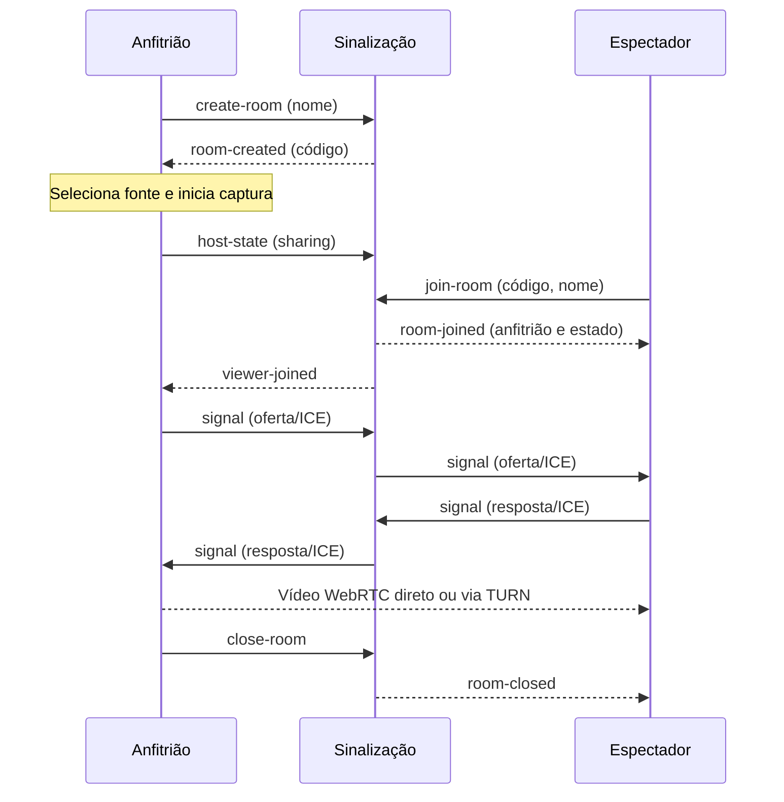

# Arquitetura e privacidade

O Discorja separa três funções:

| Componente                     | Responsabilidade                                                                                        |
| ------------------------------ | ------------------------------------------------------------------------------------------------------- |
| Processo principal do Electron | Janela do aplicativo, captura autorizada, configurações locais e atualizações.                          |
| Interface                      | Criar/entrar em salas, seleção e prévia da captura, controles e conexões WebRTC.                        |
| Sinalização WebSocket          | Criar e expirar salas, controlar participantes e encaminhar negociações entre anfitrião e espectadores. |

O processo principal usa isolamento de contexto e uma ponte de preload com operações específicas. A interface não recebe acesso genérico ao Node.js ou ao sistema de arquivos. A origem de produção do aplicativo é `app://discorja`.

## Organização do código

| Caminho                                       | Papel                                                                                    |
| --------------------------------------------- | ---------------------------------------------------------------------------------------- |
| `src/electron/main.ts`                        | Cria a janela, autoriza captura, lê/salva endpoint, protege IPC e integra o atualizador. |
| `src/electron/preload.ts`                     | Expõe apenas as operações tipadas de `DiscorjaAPI` à interface.                          |
| `src/electron/config.ts`                      | Valida endpoint e lista de servidores ICE do cliente.                                    |
| `src/renderer/app.ts`                         | Controla interface, sala, captura, preferências e atualização das métricas visíveis.     |
| `src/renderer/signal.ts`                      | Conexão WebSocket e validação das respostas de sinalização.                              |
| `src/renderer/rtc.ts`                         | Conexões de mídia, parâmetros de envio e recuperação ICE.                                |
| `src/renderer/adaptation.ts` / `telemetry.ts` | Decisões de qualidade e interpretação das estatísticas disponíveis.                      |
| `src/server/index.ts`                         | Entrada do serviço: variáveis de ambiente, porta e encerramento.                         |
| `src/server/server.ts`                        | Salas, limites, validação e encaminhamento das mensagens.                                |
| `src/shared/protocol.ts` / `quality.ts`       | Tipos das mensagens e perfis compartilhados.                                             |

O servidor não importa a interface nem o Electron. Seu build pode rodar como processo Node.js ou container Linux. O pacote desktop inclui o processo principal e a interface, sem iniciar um servidor de sinalização embutido.

## Ciclo de uma transmissão

1. O anfitrião abre uma conexão com a sinalização e cria uma sala com código aleatório de oito caracteres.
2. O anfitrião escolhe a fonte e inicia a captura. A interface mostra a prévia e o estado da transmissão.
3. Cada espectador entra pelo código. A sinalização encaminha ofertas, respostas e candidatos ICE entre os participantes autorizados.
4. O WebRTC estabelece uma conexão do anfitrião com cada espectador. O vídeo trafega diretamente ou por um TURN configurado nos clientes.
5. Parar a transmissão encerra a captura; fechar a sala invalida o convite e desconecta os espectadores. A sala também termina ao expirar ou perder o anfitrião.

As conexões de mídia WebRTC são criptografadas em trânsito. O serviço de sinalização ainda precisa ser confiável: ele conhece participantes e dados de negociação e controla o encaminhamento dessas mensagens. WSS protege a conexão entre cliente e servidor; não oferece autenticação de identidade dos amigos.

O código nasce na criação e expira a partir desse momento, mesmo sem captura. Parar vídeo muda o estado de compartilhamento; não altera o código nem prolonga a validade. Cada participante pertence a uma sala por conexão e recebe um identificador aleatório de sessão.

### Contrato de sinalização

As mensagens são JSON em WebSocket. O contrato tipado está em `src/shared/protocol.ts`; mudanças nele precisam permanecer compatíveis entre desktop e servidor.

| Mensagem do cliente         | Responsabilidade                                                                   |
| --------------------------- | ---------------------------------------------------------------------------------- |
| `create-room` / `join-room` | Criar ou entrar com nome; entrada também informa código.                           |
| `signal`                    | Encaminhar oferta, resposta ou candidato ICE ao `peerId` autorizado na mesma sala. |
| `host-state`                | Anfitrião informa se está compartilhando.                                          |
| `kick`                      | Anfitrião remove a conexão do espectador indicado.                                 |
| `close-room`                | Anfitrião encerra a sala.                                                          |
| `leave-room`                | Participante sai; se for anfitrião, a sala termina.                                |

O servidor responde com criação/entrada, mudanças de participantes, sinais, estado do anfitrião, remoção, encerramento ou erro. As razões de encerramento são `host-left`, `host-closed` e `expired`. Não há uma API HTTP de gestão de salas: HTTP expõe apenas `/health`, além do upgrade WebSocket em `/` e `/ws`.

O servidor verifica formato, tamanho, campos permitidos e autorização para encaminhar cada sinal. Não permite comunicação arbitrária entre salas ou entre espectadores. Essas verificações não autenticam a identidade informada no campo nome.

## Qualidade e recuperação

O anfitrião obtém uma captura de vídeo e a envia por uma `RTCPeerConnection` para cada espectador. Os perfis 720p/30, 1080p/30 e 1080p/60 definem limites de captura e de codificação. O orçamento total de vídeo é dividido entre os envios, e cada conexão mantém sua própria adaptação. Uma conexão com problemas não reduz, por esse motivo isolado, a captura compartilhada pelos demais.

O cliente coleta estatísticas de envio e recepção e usa observações sustentadas para reduzir ou recuperar a qualidade com intervalo entre mudanças. A interface preserva o elemento de vídeo ao atualizar o estado. A renegociação ICE tem tentativas limitadas; falha da sinalização ou encerramento da sala exige uma nova entrada, sem restaurar automaticamente um convite invalidado.

Durante a captura, o aplicativo reduz a limitação de atividade em segundo plano no anfitrião. Isso evita depender dos timers normais de uma janela inativa; a taxa de atualização da fonte ainda depende do sistema e do aplicativo capturado.

O servidor continua encaminhando somente sinalização. TURN pode retransmitir uma conexão quando necessário, mas a arquitetura mantém um envio por espectador. Uma futura SFU alteraria o caminho da mídia e a responsabilidade pela banda, pela operação e pela privacidade. Veja [qualidade e estabilidade](qualidade.md) para os limites, prioridades e cenários de validação.

## Dados e acesso

Não há conta, histórico de salas ou gravação automática. As salas são mantidas na memória do servidor. O código funciona como convite enquanto a sala está aberta, e o anfitrião pode remover espectadores. A remoção encerra a conexão atual, mas a pessoa ainda pode entrar novamente com o código. Para revogar esse convite, feche a sala e crie outra. Compartilhe-o apenas com o grupo desejado.

| Dado                                      | Local e duração                                                                                                 |
| ----------------------------------------- | --------------------------------------------------------------------------------------------------------------- |
| Código, participantes, estado e expiração | Memória de uma instância da sinalização, até encerrar/expirar ou reiniciar.                                     |
| IP e contadores de proteção               | Memória do serviço durante o controle de conexões/tentativas, sem banco incluído.                               |
| Endereço da sinalização                   | `settings.json` na pasta de dados do Electron, normalmente `%APPDATA%\Discorja`.                                |
| Nome e preferências de qualidade          | Armazenamento local da interface; não são enviados para uma conta. O nome informado entra no protocolo da sala. |
| Servidores e credenciais ICE              | Ambiente do cliente ao iniciar e configuração em memória; não há editor/renovação automática.                   |
| Quadros da tela                           | Captura e caminho de mídia WebRTC, direto ou via TURN; sem gravação automática pelo sistema.                    |
| Destino de atualização e publicador       | Metadados públicos no pacote gerado. Chave privada, senha e token pertencem ao ambiente do build.               |

Variáveis de ambiente de endpoint prevalecem sobre o valor salvo ao iniciar. `.env` só é carregado automaticamente pelos comandos de desenvolvimento. O [guia de desenvolvimento](desenvolvimento.md) separa os ambientes de cliente, servidor e build para evitar supor que uma configuração seja distribuída a todos.

Escolher uma janela ou monitor concede aos participantes acesso ao conteúdo visível naquela fonte. Revise a prévia e feche informações privadas antes de iniciar. Um espectador pode registrar o conteúdo com ferramentas próprias; o aplicativo não consegue impedir isso.

O MVP não inclui aprovação individual de novos participantes, senha adicional, recuperação de sala após reinício, emissão automática de credenciais TURN, múltiplos anfitriões, SFU, câmera ou áudio. A interface mostra o estado da captura e mantém o controle de parar disponível durante a transmissão.

## Segurança do aplicativo e do serviço

A janela usa sandbox, isolamento de contexto, `nodeIntegration` desativado e política de conteúdo restrita. O processo principal valida o remetente das chamadas IPC e aceita somente a interface local esperada. A ponte permite obter fontes, selecionar/cancelar captura, salvar endpoint, copiar código e consultar/aplicar atualização; ela não oferece execução genérica de comandos ou leitura arbitrária de arquivos.

A lista de fontes é gerada pelo processo principal. A seleção tem validade curta e uso controlado; a captura depende dessa seleção explícita e de solicitação de vídeo autorizada. Câmera e microfone são negados neste MVP. Navegação e abertura de conteúdo remoto não devem ser usadas para inserir código na interface privilegiada.

A sinalização aplica validação e limites de carga/tentativas e verifica `Origin`. O campo `Origin` não é autenticação: um cliente próprio pode enviá-lo. O código de convite também não substitui contas ou autorização persistente. Os limites usam o IP TCP; o proxy deve ser considerado ao dimensionar o uso. Veja [implantação](implantacao.md).

Não coloque segredos em `DISCORJA_ICE_SERVERS` esperando ocultá-los do usuário do computador. Credenciais de TURN precisam ter duração e consumo limitados. Não registre códigos, SDP, ICE ou conteúdo capturado para diagnosticar problemas comuns.

O atualizador de produção exige metadados de release e verifica o hash do download. A assinatura é opcional: quando há publicador configurado no pacote, também exige a assinatura Windows correspondente. A integração dos dois modos é descrita em [releases](releases.md). O fluxo de captura e as regras de conexão não comprovam, sozinhos, funcionamento de uma atualização instalada real.

## Falhas e evolução

Queda do vídeo com sinalização disponível pode disparar recuperação ICE limitada. Queda da sinalização faz o cliente limpar a sessão; a aplicação não recaptura a tela nem recupera automaticamente o convite antigo. Encerramento da sala e saída do anfitrião liberam a captura e as conexões. Reiniciar a sinalização elimina o estado em memória.

Para ampliar o público, uma SFU e autenticação/credenciais temporárias automatizadas seriam mudanças de arquitetura. Para múltiplas réplicas da sinalização, seria necessário compartilhar estado ou rotear salas e tratar falhas. Acrescentar réplicas, TURN ou bitrate não implementa essas funções por si só.

## Referências

- [Captura de tela no Electron](https://www.electronjs.org/docs/latest/api/desktop-capturer)
- [Segurança no Electron](https://www.electronjs.org/docs/latest/tutorial/security)
- [Conexões WebRTC](https://webrtc.org/getting-started/peer-connections)
