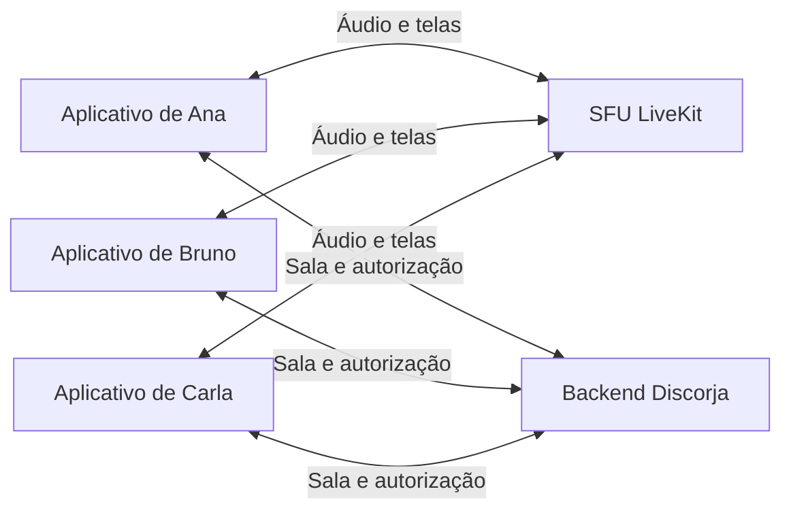

# Plano de evolução do Discorja

**Referência:** evolução da 0.2.4 para a implementação local 0.8.0.

**Status:** código e pacote Windows 0.8.0 preparados localmente: acessibilidade, estados de conexão, diagnóstico de suporte, bitrate por espectador e integridade da distribuição. O piloto continua P2P, com duas telas e uma recepção por pessoa; SFU adiada. A homologação externa da 0.8-A exige grupo, endpoint real e atualização entre instalações e permanece pendente. Não há release publicada por esta entrega.

## Objetivo

Evoluir o Discorja para um aplicativo de salas com compartilhamento de tela e áudio do computador, mantendo o controle explícito de captura e buscando qualidade estável em Windows 10/11 x64.

O resultado esperado é permitir criar e alternar salas, compartilhar áudio do computador e ter várias pessoas transmitindo telas na mesma sala. O aplicativo deve mostrar claramente quem está transmitindo e o que cada participante está recebendo.

**Escopo definido:** a conversa por voz continuará no Discord. Captura de microfone, chamada de voz e indicadores de fala ficam fora deste plano; a permissão de microfone permanece negada no Discorja. O áudio previsto aqui é o conteúdo compartilhado, como jogos e vídeos.

**Foco da segurança:** proteger os computadores, o servidor e as atualizações contra invasão, execução de código e abuso de recursos. Prints e gravações pelos espectadores são aceitos. Bloqueios de cópia, DRM e exigências de sigilo da transmissão ficam fora do escopo; aprovação manual de entrada e rotação de convite são opcionais para futura moderação.

**Restrição de orçamento:** nenhuma etapa pode exigir compra, assinatura, servidor alugado, domínio pago ou cobrança por consumo. Usar o computador e a conexão já disponíveis e serviços gratuitos com bloqueio de excedentes confirmado. Ao atingir limites, reduzir capacidade ou suspender o recurso; não fazer upgrade automático. Energia, internet e disponibilidade da máquina continuam sendo recursos necessários. O plano não promete custo operacional absoluto zero nem funcionamento ilimitado.

A revisão de riscos, os controles existentes e as melhorias propostas estão em [Segurança e operação sem serviços pagos](seguranca.md). As implementações e pendências da 0.3.0 estão no registro de progresso e no [relatório de validação](versões/validacao-0.3.0.md); não confundir código implementado com configuração verificada no servidor real.

## Referência anterior: código 0.2.4

| Área                | Situação no código revisado                                                                                              |
| ------------------- | ------------------------------------------------------------------------------------------------------------------------ |
| Aplicativo          | Electron + TypeScript; transmissão de vídeo por WebRTC.                                                                  |
| Qualidade           | Perfis 720p/30, 1080p/30 e 1080p/60, orçamento de upload, adaptação por espectador e diagnóstico.                        |
| Salas no servidor   | Já aceita várias salas independentes, limitadas por `MAX_ROOMS`. Isso permite grupos diferentes usando o mesmo servidor. |
| Salas no aplicativo | Uma sala por conexão; a interface possui um único estado de sala.                                                        |
| Transmissores       | Um anfitrião transmite para os espectadores. O protocolo e os controles dependem desse papel.                            |
| Áudio               | Captura de áudio e microfone são negadas. O fluxo atual solicita somente vídeo.                                          |
| Conectividade       | STUN padrão; TURN configurável manualmente no ambiente dos clientes; recuperação ICE limitada.                           |
| Monitoramento       | `/health` indica disponibilidade do processo. Ainda não há rota de contagem de participantes.                            |
| Distribuição        | GitHub Releases, com assinatura opcional.                                                                                |

Os testes locais anteriores estão em [validação da versão 0.2.0](versões/validacao-0.2.0.md). As amostras curtas ali registradas não certificam 1080p/60 sustentado entre computadores diferentes.

## Direção técnica

Manter Electron + TypeScript para o aplicativo e WebRTC para mídia. A base será P2P para grupos pequenos, com limites medidos de participantes e telas. A etapa 0.6.0 avalia **LiveKit/SFU auto-hospedado em computador já disponível**, somente se não exigir contratação ou aquisição. Essa avaliação não é requisito para liberar um piloto pequeno de várias telas por P2P.

Uma SFU recebe os fluxos publicados e encaminha aos assinantes. Isso reduz a necessidade de cada transmissor enviar uma cópia para cada espectador. O servidor passa a transportar vídeo e áudio, com exigências próprias de rede, operação e banda.

**Limites atuais do piloto:** até dez participantes totais por sala, uma tela por pessoa e duas telas simultâneas. Cada participante escolhe **uma única transmissão para assistir por vez**; entrar na sala não recebe vídeos automaticamente. São limites de configuração, não capacidades garantidas. Captura própria e recepção escolhida são independentes.

## Sequência de entregas

| Etapa proposta | Prioridade | Entrega principal                                                                                                                          | Depende de                                        |
| -------------- | ---------- | ------------------------------------------------------------------------------------------------------------------------------------------ | ------------------------------------------------- |
| 0.3.0          | P0         | Segurança, desempenho, conexão e rota de estatísticas                                                                                      | Base atual                                        |
| 0.4.0          | P1         | Áudio do computador na transmissão, com testes junto ao Discord                                                                            | Diagnóstico e controle de captura                 |
| 0.5.0          | P1         | Navegação entre salas, participantes e permissões(quando alternar para uma sala, a outra deve minimizar o quanto está puxando de internet) | Modelo de sessão e protocolo revisados            |
| 0.6.0          | Opcional   | Avaliação de SFU em máquina existente, sem contratar serviços                                                                              | Hardware, rede e autorização validados            |
| 0.7.0          | P1         | Várias pessoas compartilhando tela na mesma sala                                                                                           | Publicação/assinatura independentes e limites P2P |
| 0.8.0          | P2         | Ajustes de escala, acessibilidade e operação                                                                                               | Testes com o grupo real                           |
| 1.0.0          | Marco      | Distribuição estável da experiência de salas                                                                                               | Critérios de aceite deste plano                   |

P0 organiza a próxima entrega. P1 amplia o produto. P2 consolida a operação. Cada etapa deve gerar uma versão revisável e funcionar antes de liberar a seguinte.

## Execução por etapas pequenas

As versões acima agrupam funcionalidades; **não devem ser implementadas inteiras em uma única sessão**. A unidade de trabalho é uma subetapa da tabela abaixo. Segurança faz parte das entregas e dos testes, usando [seguranca.md](seguranca.md) como referência técnica.

**Regra de execução:** trabalhar somente na subetapa solicitada. Ao concluí-la, registrar alterações, verificações e pendências e entregar o resultado para revisão. Não iniciar automaticamente a seguinte, salvo pedido explícito para executar mais de uma. Uma subetapa ainda grande deve ser dividida e registrada antes de continuar. Os números de versão permanecem propostas; concluir uma subetapa não exige publicar uma release nem alterar a versão do pacote.

Essa organização reduz o risco de perder o ponto de retomada, mas não garante a duração de uma sessão ou a disponibilidade do ambiente. O registro em arquivo permite continuar o trabalho se houver interrupção.

### Ordem de implementação e critérios de conclusão

| ID     | Entrega delimitada                         | Segurança incluída e critério para concluir                                                                                                                                                                                                                                | Pré-requisito                              |
| ------ | ------------------------------------------ | -------------------------------------------------------------------------------------------------------------------------------------------------------------------------------------------------------------------------------------------------------------------------- | ------------------------------------------ |
| 0.3-A  | Dependências e processo de compilação      | Investigar os oito alertas moderados registrados, aplicar correção compatível ou documentar exceção justificada; repetir auditoria, build e geração de pacote afetados. Não usar correção forçada sem análise.                                                             | Base atual                                 |
| 0.3-B  | Isolamento do aplicativo                   | Revisar preload, IPC, navegação e protocolo local; testar solicitações não autorizadas, caminhos fora do diretório e tentativa de execução via dados remotos. Preservar sandbox e Node desabilitado na interface.                                                          | 0.3-A                                      |
| 0.3-C1 | Validação do backend e do cliente          | Limitar mensagens, strings, SDP, ICE e operações por peer; testar payloads malformados/grandes, falsificação de papel e acesso entre salas. Uma entrada inválida não pode executar código nem criar crescimento ilimitado de recursos.                                     | 0.3-B                                      |
| 0.3-C2 | Proteção da máquina que hospeda o servidor | Documentar e verificar usuário sem privilégios, portas, arquivos, segredos e proxy no ambiente real disponível. Servidor não guarda credenciais de publicação. Testar servidor de sinalização malicioso contra o app; registrar controles não verificáveis como pendentes. | 0.3-C1 e acesso ao ambiente de implantação |
| 0.3-D  | Rota `GET /api/stats`                      | Implementar agregados, autenticação administrativa, limite de consultas e `no-store`; testar contagens, token inválido e ciclos de conexão. Sem credencial configurada, rota fica desabilitada.                                                                            | 0.3-C1                                     |
| 0.3-E1 | Proteção do canal de atualização           | Revisar conta/workflow, permissões, origem do updater e tratamento de pacote inválido. Sinalização não escolhe executáveis. Assinatura permanece opcional; nenhuma contratação. Configurações de conta não inspecionadas ficam pendentes.                                  | 0.3-A e 0.3-B                              |
| 0.3-E2 | Popup de atualização ao abrir              | Implementar aviso, atualizar/depois, progresso e reinício explícito; testar uma atualização real entre duas versões instaladas, falta de rede e transmissão ativa. Textos/eventos vêm do updater validado, sem HTML remoto.                                                | 0.3-E1 e distribuição configurada          |
| 0.3-F  | Medição e otimização de qualidade          | Registrar referência de desempenho e aplicar ajustes medidos; validar os perfis em sessão sustentada e limpar recursos. Diagnóstico não exporta credenciais ou conteúdo da tela.                                                                                           | 0.3-C1                                     |
| 0.3-G1 | Recuperação de conexão P2P                 | Implementar recuperação e limpeza sem restaurar privilégios pelo estado do cliente nem iniciar captura remotamente; testar interrupção, saída e remoção.                                                                                                                   | 0.3-C1 e 0.3-F                             |
| 0.3-G2 | TURN próprio opcional                      | Somente com máquina/rede existentes: validar credenciais temporárias, limites e restrições de destino; confirmar rota real. Se exigir pagamento ou infraestrutura indisponível, marcar como adiada sem bloquear P2P.                                                       | 0.3-C2 e 0.3-G1                            |
| 0.4-A  | Captura de áudio do computador             | Adicionar escolha e parada do áudio, mantendo microfone/câmera negados. Testar permissão, silêncio, troca/perda de dispositivo e encerramento das tracks.                                                                                                                  | Base 0.3 validada; TURN opcional           |
| 0.4-B  | Qualidade de áudio e uso com Discord       | Testar sincronização, duplicação e recaptura; documentar configurações suportadas e transmissão sem som. Não anunciar isolamento de áudio não comprovado.                                                                                                                  | 0.4-A                                      |
| 0.5-A  | Sessão, papéis e protocolo de salas        | Separar dono/publicador/participante; validar permissões no servidor e compatibilidade de clientes. Sem exigir aprovação manual ou proteção contra prints.                                                                                                                 | Base 0.3 validada                          |
| 0.5-B  | Interface e troca de salas                 | Implementar criação/navegação/troca, encerrando mídia anterior ou suspendendo recepção inativa conforme o modo definido. Testar isolamento, liberação de recursos e redução real de tráfego nas salas sem visualização.                                                    | 0.5-A e 0.4-B para salas com áudio         |
| 0.6-A  | Viabilidade de SFU própria, opcional       | Medir máquina/rede já disponíveis e confirmar ausência de contratação. Sem capacidade gratuita adequada, marcar como adiada e seguir com P2P limitado.                                                                                                                     | 0.3-C2 e 0.5-A                             |
| 0.6-B  | Piloto da SFU, opcional                    | Validar tokens por sala/papel, limites de mídia, portas e credenciais administrativas restritas; não liberar serviço de retransmissão aberto.                                                                                                                              | 0.6-A aprovada                             |
| 0.7-A  | Publicações simultâneas e assinaturas      | Implementar duas telas no piloto P2P, com IDs independentes, limites e autorização por publicador. Parar uma tela não encerra a outra. SFU só entra se validada sem contratação.                                                                                           | 0.5-B; 0.6-B apenas para modo SFU          |
| 0.7-B  | Cartões, destaque e orçamento de mídia     | Receber apenas uma tela por pessoa, encerrar a recepção anterior ao trocar, pausar prévia própria em segundo plano, controlar áudio e medir recursos.                                                                                                                      | 0.7-A                                      |
| 0.8-A  | Operação e consolidação                    | Testar com o grupo, conferir atualização/protocolo, limites gratuitos, logs e procedimento de incidente. Nenhum serviço pago é requisito.                                                                                                                                  | Etapas obrigatórias anteriores             |

Configuração externa necessária deve ser listada ao final da subetapa com instruções concretas. Não marcar como validado um servidor, conta ou atualização instalada que não tenha sido efetivamente testado. Trabalho independente pode avançar em outra solicitação se não depender dessa verificação; o item pendente permanece explícito.

### Registro de progresso e retomada

**Estado atual:** implementação local 0.8.0 preparada sobre a base 0.5.0 do commit `cac0121`, incluindo as entregas 0.7-A/B e a consolidação de interface, diagnóstico, bitrate e distribuição. A 0.4 foi enviada separadamente em `cc0c79a`; a SFU 0.6-B continua adiada. Resultados atuais em [validacao-0.8.0.md](versões/validacao-0.8.0.md). A homologação externa da 0.8-A permanece pendente conforme [operacao.md](operacao.md): endpoint real, grupo em redes diferentes, áudio nativo/Discord e atualização entre instalações. Código e pacote locais não certificam as contas ou o host da hospedagem.

Ao terminar ou interromper uma subetapa, atualizar este registro no próprio arquivo. Manter uma entrada por subetapa trabalhada; não sobrescrever o histórico de entregas anteriores.

| Campo                | O que registrar                                                                                                        |
| -------------------- | ---------------------------------------------------------------------------------------------------------------------- |
| Subetapa e estado    | ID; a fazer, em andamento, concluída, aguardando configuração ou adiada por ser opcional.                              |
| Escopo entregue      | Comportamento alterado e arquivos relevantes.                                                                          |
| Verificações         | Comandos/cenários executados, resultados e o que não foi testado.                                                      |
| Configuração externa | Variáveis, conta ou implantação necessárias, sem copiar valores secretos.                                              |
| Pendências e riscos  | Falhas restantes e limite do que a entrega permite afirmar.                                                            |
| Ponto de retomada    | Próxima ação concreta dentro da subetapa incompleta ou próximo ID recomendado.                                         |
| Referência do código | Commit, se já existir; caso contrário, indicar alterações locais sem commit. Não publicar ou commitar automaticamente. |

**Como solicitar:** "Implemente somente a etapa 0.3-A do plano e atualize o registro de progresso ao terminar." Para retomar: "Leia o registro e continue a subetapa que ficou incompleta." Antes de editar, conferir o estado real dos arquivos para preservar mudanças feitas pelo desenvolvedor desde a última sessão.

#### Entrega 0.3-A — Dependências e empacotamento

**Data:** 15 de outubro de 2026. **Estado:** concluída.

- **Escopo entregue:** override de `global-agent` para 4.1.3 exclusivamente no downloader `@electron/get@3.1.0` usado pelo empacotador. Removida a cadeia `roarr`/`sprintf-js`; mantidos `electron-builder` 26.15.3 e versão do app 0.2.4. Arquivos: `package.json`, `package-lock.json`, `tests/packaging-download.test.ts` e documentação de segurança/progresso.
- **Motivo:** o aviso raiz não tem versão corrigida de `sprintf-js` publicada. A substituição remove a dependência vulnerável sem rebaixar o empacotador para a versão sugerida pelo audit nem ignorar o aviso.
- **Verificações:** instalação limpa com `npm ci`; auditoria completa e de produção sem alertas conhecidos; 74 testes aprovados em sete arquivos; verificação de tipos e compilação aprovadas. Os três testes novos cobrem download via proxy HTTP local, exclusão do proxy e rejeição de checksum inválido usando o downloader real do empacotador.
- **Pacote validado:** `npm run dist:win -- --publish never`, com repositório `DevCordeirocf/Discorja` e assinatura desabilitada, gerou `release/Discorja-Setup-0.2.4.exe`, `.blockmap` e `latest.yml`. SHA-512 e tamanho do instalador conferidos contra o manifesto; configuração de updater conferida no pacote; Authenticode retornou `NotSigned`, conforme o modo opcional.
- **Configuração externa:** nenhuma contratação ou nova variável obrigatória. O override será reproduzido pelo lockfile. Para gerar pacote com updater, continua necessária a configuração de distribuição já documentada. A geração de teste foi somente local, sem publicação.
- **Pendências e limites:** não foi executado o instalador no Windows nem validada atualização entre duas instalações nesta subetapa. Não foi testado proxy corporativo HTTPS com autenticação. A proteção de IPC, backend, hospedagem e canal de publicação permanece nas próximas etapas. Reavaliar o override quando o empacotador atualizar seu downloader, repetindo os ensaios antes de removê-lo.
- **Ponto de retomada:** iniciar somente **0.3-B — Isolamento do aplicativo**, após solicitação. Não iniciar popup, estatísticas ou áudio nesta entrega.
- **Referência do código:** alterações locais sem commit; sem release publicada.

#### Entrega 0.3.0 — Demais subetapas

**Data:** 15 de outubro de 2026. **Autorização:** pedido para finalizar toda a etapa 3, ampliando a execução além de uma única subetapa. **Referência:** alterações locais sem commit, versão 0.3.0; sem publicação.

| ID     | Estado e escopo entregue                                                                                                                | Verificações e pendências                                                                                                                                                                                                                                                                |
| ------ | --------------------------------------------------------------------------------------------------------------------------------------- | ---------------------------------------------------------------------------------------------------------------------------------------------------------------------------------------------------------------------------------------------------------------------------------------- |
| 0.3-B  | Concluída localmente: `security.ts`, políticas de IPC/protocolo/navegação e isolamento.                                                 | Testes unitários e app real recusam configuração insegura, seleção inválida e tentativa de acesso fora do diretório.                                                                                                                                                                     |
| 0.3-C1 | Concluída localmente: validação estrita das respostas, tamanho/frequência de mensagens, limites de negociações e filas.                 | Testes de mensagens inválidas, papéis, salas e fechamento após abuso aprovados.                                                                                                                                                                                                          |
| 0.3-C2 | Implementação preparada; aguardando configuração/verificação do host.                                                                   | Dockerfile/compose e guia de implantação atualizados. Docker e servidor remoto não disponíveis para testar usuário, permissões, portas ou proxy reais. Não marcar esses controles como conferidos.                                                                                       |
| 0.3-D  | Concluída localmente: estatísticas agregadas, Bearer, segredo somente no servidor, limite de 30/min/IP e rota desabilitada sem segredo. | Testes cobrem autenticação, limites, vínculos, retomada, expulsão e expiração. Cadastrar `STATS_TOKEN` na implantação para habilitar.                                                                                                                                                    |
| 0.3-E1 | Código/workflows preparados; aguardando conferência das contas.                                                                         | Actions fixadas por SHA oficial, checkout sem credencial persistida, audit no CI/release e Dependabot configurados. Busca limitada não encontrou padrões de chaves/tokens. 2FA, permissões, proteção de branch e bloqueios de cobrança ainda precisam ser conferidos.                    |
| 0.3-E2 | Implementada e testada localmente; ensaio de instalação real pendente.                                                                  | Popup, adiar, progresso, pacote inválido e download validado testados com updater real/provedor local. Teste não executa instalador nem comprova atualização entre releases publicadas.                                                                                                  |
| 0.3-F  | Implementada e medida localmente; ensaio prolongado externo pendente.                                                                   | Reserva de 15% do orçamento, preferência de codec mantendo alternativas, métricas de codificador/jitter/congelamento e exportação sanitizada. Comparação local VP8/H264 e sessão extra curta registradas; faltam 30 minutos entre máquinas/redes separadas com um e quatro espectadores. |
| 0.3-G1 | Concluída localmente: credenciais de retomada em memória, rotação, prazo limitado e renegociação sem nova captura.                      | Testes de expiração/reutilização/expulsão e retomada do anfitrião no app real aprovados. O ensaio também cobre retomada do espectador. Reinício do backend continua encerrando salas.                                                                                                    |
| 0.3-G2 | Adiada, opcional.                                                                                                                       | Nenhum TURN contratado ou publicado. Sem infraestrutura própria validada, permanece P2P com limitações conhecidas entre certas redes.                                                                                                                                                    |

**Verificações da entrega:** 85 testes em oito arquivos, tipos, build e formatação aprovados; instalador Windows 0.3.0 sem assinatura gerado com publicação desabilitada. Primeiro ensaio empacotado: 21 cenários com codec/rede e um minuto adicional local; ensaio do updater real: quatro cenários, sem instalação. Relatório e limites em [validacao-0.3.0.md](versões/validacao-0.3.0.md).

**Fechamento da rodada:** o código final passou em 20 cenários reais no modo de desenvolvimento após corrigir o timer de avisos. A política Device Guard deste Windows bloqueou a última cópia do executável empacotado, portanto sua execução final não foi comprovada. Os ensaios empacotados anteriores não substituem essa verificação. Não foi alterada a política do sistema.

**Ponto de retomada:** implantar o backend preparado, conferir sua configuração, publicar/testar os artefatos e executar os ensaios operacionais pendentes antes de considerar a 0.3.0 validada no ambiente real. Os detalhes estão no relatório de validação. Nenhuma etapa posterior ou serviço pago é necessário para encerrar essas verificações.

#### Entrega 0.4-A e 0.4-B — Som do computador e qualidade de áudio

**Data:** 15 de outubro de 2026. **Estado:** implementação concluída; aguardando validação operacional.

- **Escopo:** consentimento por captura; loopback Windows; negação de microfone/câmera; envio de áudio com vídeo; mute, encerramento independente e volume recebido; reserva de banda; métricas; falhas de fonte/dispositivo e reconexão. Pacote 0.4.0, sem novas dependências ou serviços pagos.
- **Verificações:** 93 testes em nove arquivos, tipos e build aprovados. Vinte cenários integrados de vídeo e quinze de áudio aprovados; dois minutos adicionais de áudio/vídeo contínuos. O áudio integrado usa somente um frame de teste gerado, em substituição ao loopback nativo, para não capturar som pessoal. Limites em [validacao-0.4.0.md](versões/validacao-0.4.0.md).
- **Configuração externa:** nenhuma variável nova no servidor. Mesma sinalização e ICE. Usar cliente 0.4.0 nos dois lados, saída de áudio disponível e opção de som marcada por captura. Publicação da release permanece uma ação separada.
- **Pendências:** loopback em Windows 10/11, troca física de saída, chamada real do Discord, sincronização por trinta minutos e carga em redes distintas. Não há captura exclusiva de processo ou exclusão automática do Discord. Durante a chamada, manter somente vídeo se o isolamento não foi comprovado.
- **Retomada:** seguir a matriz de validação e o [guia de áudio](audio.md). Não iniciar 0.5 automaticamente. Código local sem commit ou publicação automática nesta entrega.

#### Entrega 0.5-A e 0.5-B — Papéis, protocolo e navegação de salas

**Estado:** implementação concluída; aguardando distribuição e validação operacional.

- **Escopo:** protocolo 2 confirmado; dono/moderador/participante separados do transmissor; autorização no servidor; sessões retomadas sem confiar em papel do cliente; salas nomeadas, convites recentes e troca com encerramento da mídia anterior. Uma sala de mídia ativa por aplicativo e uma publicação por sala.
- **Verificações:** 101 testes em onze arquivos, tipos e build aprovados; vinte cenários integrados de vídeo, dezesseis de áudio e dez de salas aprovados. Troca com áudio, mudança de transmissor, retirada de moderação, captura sempre explícita, isolamento de salas/protocolos e destino inexistente cobertos.
- **Configuração externa:** implantar servidor 0.5.0 primeiro, conferir WSS/origens/limites e distribuir cliente 0.5.0; nenhuma variável ou contratação nova. Clientes antigos continuam somente em salas do protocolo anterior. Reiniciar o servidor encerra salas em memória.
- **Pendências:** instalação/atualização real e testes com máquinas/redes diferentes; continuam os ensaios de áudio nativo/Discord das entregas anteriores. Não houve publicação da 0.5.0 nesta rodada.
- **Retomada:** seguir [salas.md](salas.md) e [validacao-0.5.0.md](versões/validacao-0.5.0.md). As alterações 0.5.0 estão locais, separadas do commit publicado da 0.4.0. Não iniciar a etapa seguinte automaticamente.

#### Avaliação 0.6-A — Viabilidade de SFU própria

**Data:** 16 de outubro de 2026. **Estado:** avaliação encerrada; SFU adiada por decisão do responsável. Não há hospedagem disponível e o uso ocasional pelo grupo pequeno não justifica a estrutura.

- **Entregue:** análise da topologia, orçamento ilustrativo de banda, inventário básico do PC de desenvolvimento e conferência da documentação oficial do LiveKit/Render. Registro em [viabilidade-0.6.0.md](versões/viabilidade-0.6.0.md).
- **Constatação:** SFU precisa estar disponível durante suas sessões. Na mesma conexão do transmissor, a distribuição continua consumindo o upload daquela conexão. Render Free permanece apenas como sinalização nesta proposta.
- **Decisão:** manter P2P e não implementar 0.6-B no escopo atual. Não há definição de host pendente; a análise de infraestrutura fica como referência para eventual reconsideração.
- **Limites:** sem instalação, contratação, abertura de portas, serviço persistente ou nova dependência. Pacote permanece 0.5.0. A próxima implementação, quando solicitada, é a 0.7-A em P2P limitado.

#### Entrega 0.7-A e 0.7-B — Publicações e interface dinâmica

**Data:** 16 de outubro de 2026. **Estado:** implementação local preparada; aguardando distribuição e homologação externa.

- **Escopo:** protocolo 3, até duas publicações no piloto, uma tela própria e uma recepção escolhida por pessoa; cartões sem vídeo oculto; captura e recepção em controladores separados; parada e moderação individuais. Áudio recebido bloqueado durante captura de som próprio, sem microfone/câmera. Prévia própria pausada e desconectada do player em segundo plano, sem reconfigurar a captura enviada.
- **Estabilidade e segurança:** autorização por sala/publicação/assinatura; IDs e limites validados nos dois lados; confirmação da seleção antes de aceitar ofertas; repetição da mesma seleção renova a conexão; limpeza de tracks, peers e contadores. Enumeração de fontes serializada com fila limitada para evitar lista antiga ao cancelar/reabrir rapidamente.
- **Verificações:** resultados dos testes automatizados e ensaios integrados registrados em [validacao-0.7.0.md](versões/validacao-0.7.0.md), com limitações de memória, áudio nativo e ambiente descritas.
- **Configuração externa:** implantar o servidor primeiro, manter `MAX_PUBLISHERS=2`, conferir limites e WSS e distribuir clientes compatíveis. Não há contratação, SFU ou nova dependência. Assinatura opcional e fluxo de GitHub Releases preservados.
- **Referência:** versão do pacote 0.7.0; alterações locais sem commit ou publicação por esta entrega.

#### Início 0.8-A — Operação e consolidação (registro anterior)

**Estado:** em andamento. **Autorização:** pedido para continuar e partir para o próximo passo.

- **Entregue localmente:** `npm run server:check` verifica saúde, protocolo 3 e estatísticas opcionais sem criar sala, capturar mídia ou expor segredos. TLS permanece obrigatório fora de localhost, sem redirecionamentos. Respostas e tempos são limitados. Guia separado em [operacao.md](operacao.md), mantendo o README focado no produto.
- **Validação:** testes cobrem sucesso, protocolo antigo, estatísticas desabilitadas/token inválido e endpoints inseguros. Nenhuma conta ou servidor remoto foi modificado.
- **Ponto de retomada:** implantar e rodar o diagnóstico no endpoint real; executar o roteiro com o grupo por pelo menos 30 minutos; validar áudio junto ao Discord e uma atualização entre duas instalações publicadas. Essas verificações exigem o ambiente real e não estão concluídas.

#### Entrega 0.8.0 — Consolidação local

**Data:** 16 de outubro de 2026. **Estado:** código e pacote local concluídos; homologação externa da 0.8-A pendente. **Autorização:** pedido explícito para finalizar a 0.8; ajuste de bitrate incluído após a solicitação para permitir maior tráfego de vídeo.

- **Interface e acessibilidade:** preservação de foco/caret e menus em snapshots; Tab/Shift+Tab nos controles visíveis de diálogos; Escape e retorno de foco; atalho para o conteúdo; anunciador persistente sem repetições por renderização; estados de conexão/recuperação claros e atualização explícita da lista de janelas.
- **Qualidade:** teto de vídeo personalizado de 1 a 30 Mbps por espectador, conversão para MB/s, retorno ao padrão do perfil e alteração durante a captura. O orçamento total, áudio e adaptação continuam limitando o envio. Não há bitrate mínimo nem tráfego artificial para consumir toda a banda.
- **Operação e segurança:** relatório de suporte schema 2 com contexto validado e runtime fornecido pelo processo principal, sem identificadores/segredos/conteúdo. Diagnóstico do servidor mantido. Validador de manifesto/tamanho/SHA-512/blockmap no workflow, que seleciona somente os artefatos da versão atual. Assinatura continua opcional.
- **Verificação e distribuição:** testes automatizados e integrados, ensaio contínuo local e pacote NSIS registrados em [validacao-0.8.0.md](versões/validacao-0.8.0.md). Executável empacotado e atualizador real exercitados em perfis/cache de teste; nenhuma instalação existente foi substituída.
- **Configuração externa:** nenhum serviço pago ou variável de servidor nova. Confirmar endpoint WSS, protocolo 3, limites gratuitos e implantação; publicar a release somente pelo procedimento revisado em [releases.md](releases.md).
- **Referência:** versão 0.8.0 local, sem commit/push ou release publicados por esta entrega. Não iniciar a 1.0 automaticamente.

## 0.3.0 — Performance, conexão e monitoramento

### Segurança prioritária

- Preservar sandbox, isolamento, preload limitado e validação IPC. Testar que dados remotos não permitem executar comandos, abrir programas ou acessar arquivos do computador.
- Manter verificação de papéis e vínculo com a sala no servidor; impedir que IDs ou estado enviados pelo cliente concedam privilégios administrativos. Código de sala permanece um convite compartilhável.
- Manter WSS fora do computador local, sem ignorar erros de certificado TLS. Restringir origens de produção e tratar `Origin` como filtro, não autenticação.
- Validar mensagens recebidas pelo aplicativo com limites equivalentes aos do servidor, antes de processar nomes, SDP e candidatos ICE.
- Proteger `/api/stats`, limitar seu uso e devolver somente os agregados previstos abaixo.
- Reduzir limites globais ao tamanho do grupo e testar o comportamento atrás do proxy da hospedagem, sem confiar indiscriminadamente em cabeçalhos de IP.
- Revisar dependências, segredos e permissões do fluxo de releases; manter assinatura Authenticode opcional, sem exigir certificado pago.
- Aplicar os critérios e testes descritos em [seguranca.md](seguranca.md).

O servidor publicado também faz parte da superfície de ataque: proteger seu processo, dependências, credenciais e acesso à máquina hospedeira. Separar a sinalização do canal de atualizações, para que comprometer o servidor não permita distribuir executáveis aos clientes. Detalhes e testes estão na seção [proteção do servidor e contenção de invasão](seguranca.md#p0--proteção-do-servidor-e-contenção-de-invasão).

### Popup de atualização ao abrir o aplicativo

**Entrega prevista na 0.3.0:** ao iniciar uma versão instalada com updater configurado, consultar o GitHub Releases e abrir um popup quando existir versão estável mais recente. A consulta atual já é iniciada pelo processo principal; a novidade é apresentar o aviso e organizar o fluxo de atualização na interface.

- Mostrar "Atualização disponível", versão instalada e versão nova, com os botões **Atualizar agora** e **Depois**. Sem versão nova, não abrir popup.
- Ao escolher atualizar, iniciar ou acompanhar o download e mostrar progresso. Coordenar com o download automático existente para não duplicar requisições nem apresentar um botão que sugira um download ainda não iniciado quando ele já estiver em andamento.
- Quando o pacote estiver validado e pronto, oferecer **Reiniciar e atualizar** ou **Depois**. Reiniciar somente por ação explícita, avisando se houver transmissão ativa; encerrar mídia/conexões antes de sair.
- Ao escolher depois, permitir continuar usando o app, manter acesso ao estado da atualização e evitar repetir o popup durante a mesma execução. Na próxima abertura, avisar novamente se a atualização continuar pendente.
- Sem internet ou com falha na consulta, permitir abrir o app normalmente e tentar novamente pelo controle de atualizações. Não oferecer downgrade ou versão preliminar por padrão.
- Obter versão e estado pelo processo principal e pelo repositório configurado no pacote. Não aceitar indicação de instalador enviada pelo servidor de sinalização; renderizar textos como texto, sem HTML remoto.
- Manter GitHub Releases e assinatura opcional, sem serviço pago adicional. Em execução de desenvolvimento ou pacote sem updater configurado, não simular atualização disponível.

**Aceite:** testar versão atual, versão nova, download em andamento/concluído, opção depois, ausência de rede e arquivo inválido. Verificar uma atualização real entre duas versões instaladas. Confirmar que o popup não se repete na mesma execução e que transmissão ativa não é interrompida sem confirmação. Uma mensagem de sinalização adulterada não abre o popup nem altera a origem do download.

### Qualidade e processamento

- Identificar codec e codificador efetivos quando o Chromium disponibilizar esses dados. Exibir estado desconhecido quando não houver informação suficiente para afirmar uso de GPU.
- Medir resolução/FPS recebidos, bitrate, perda, RTT, jitter, quadros descartados e congelamentos disponíveis. Separar métricas da captura, do envio e da recepção.
- Comparar os codecs disponíveis nos dois computadores e verificar se a codificação por hardware melhora o cenário real, mantendo alternativa compatível.
- Ajustar a adaptação para preservar legibilidade: quando necessário, comparar a redução para 30 FPS com a redução excessiva de resolução.
- Evitar filas de quadros antigos, coletas de estatísticas sobrepostas e atualizações de interface que interrompam o vídeo.
- Aplicar orçamento de envio com folga para o tráfego adicional. Com mais publicações, o orçamento precisa considerar a soma de todas elas.
- Criar um relatório de diagnóstico exportável com métricas e versões, sem incluir tela, credenciais, nomes, códigos de sala, SDP ou IPs.

### Conectividade

- Tentar conexão direta primeiro. Avaliar TURN gratuito auto-hospedado somente em máquina e conexão já disponíveis; se não for viável sem despesas adicionais, manter o recurso desabilitado e informar a limitação de conexão entre certas redes.
- Quando houver TURN próprio, automatizar a entrega de credenciais temporárias para sessões autorizadas, com prazo e consumo limitados. Não depender de servidores TURN públicos anônimos ou de testes gratuitos que depois exijam pagamento.
- Manter o segredo de emissão somente no servidor. Credenciais de uso temporário chegam ao cliente por uma conexão autenticada e protegida.
- Cobrir transporte UDP e alternativas TCP/TLS conforme a infraestrutura, medindo a rota realmente selecionada.
- Projetar reconexão da sinalização com espera progressiva e período curto de retomada da sessão. A retomada precisa validar a identidade da sessão e respeitar expulsão, encerramento e expiração da sala.
- Liberar conexões, tracks e codificadores antigos quando a recuperação falhar. Não iniciar nova captura sem autorização do usuário.

**Aceite:** ensaio de pelo menos 30 minutos com um e quatro espectadores, computadores separados e redes distintas; comparação dos três perfis; recuperação controlada de interrupções breves. Quando TURN próprio estiver disponível, confirmar seu uso real; caso contrário, registrar os cenários que não conectam, sem bloquear a entrega P2P. Registrar regressões de qualidade e processamento contra a referência anterior.

### Rota para verificar quantas pessoas estão conectadas

**Entrega prevista nesta etapa:** `GET /api/stats`, separada de `/health`.

Antes de apresentar um número como "pessoas", o sistema precisa distinguir os conceitos abaixo. Atualmente, duas instâncias abertas pela mesma pessoa podem ser contadas como duas conexões; ainda não há uma identidade de conta para deduplicar pessoas.

| Campo proposto             | Significado                                                                                                           |
| -------------------------- | --------------------------------------------------------------------------------------------------------------------- |
| `websocketConnections`     | Conexões WebSocket aceitas e abertas, inclusive as que ainda não entraram em uma sala.                                |
| `participantSessions`      | Sessões conectadas que pertencem a pelo menos uma sala, contadas uma vez por sessão.                                  |
| `roomMemberships`          | Total de vínculos de sessões com salas. Pode diferir do campo anterior se a participação simultânea for implementada. |
| `activeRooms`              | Salas ainda válidas na instância.                                                                                     |
| `reportedScreenPublishers` | Sessões que informaram compartilhamento de tela ativo; não comprova recepção de vídeo.                                |
| `scope`                    | Escopo da contagem: inicialmente `instance`, porque o estado está em um único processo.                               |
| `generatedAt`              | Horário UTC da fotografia dos contadores.                                                                             |

Exemplo de resposta planejada, com números ilustrativos:

```json
{
  "schemaVersion": 1,
  "scope": "instance",
  "websocketConnections": 7,
  "participantSessions": 5,
  "roomMemberships": 5,
  "activeRooms": 2,
  "reportedScreenPublishers": 1,
  "generatedAt": "2026-10-15T18:00:00Z"
}
```

**Regras de implementação:**

- Ler o estado vivo das conexões e salas, tratando fechamento, saída, remoção, expiração e conexões interrompidas detectadas pelo heartbeat.
- Contar conexões abertas, não tentativas recusadas ou o histórico de visitas. O heartbeat introduz um intervalo até detectar uma conexão perdida sem encerramento normal.
- Retornar dados agregados. Não expor nomes, IPs, códigos, tokens ou detalhes das salas.
- Proteger a rota administrativa com credencial de monitoramento no servidor e limitar consultas. Essa credencial não será embutida no aplicativo.
- Caso seja necessário mostrar um número em página pública, criar uma resposta pública reduzida e explicitamente habilitada, sem distribuir a credencial administrativa.
- Usar `Cache-Control: no-store`. Um painel pode consultar a cada 5–10 segundos; as consultas precisam respeitar os limites definidos para a rota.
- Indicar que contadores em memória reiniciam com o processo. Contagem histórica exigirá armazenamento adicional.
- Depois da SFU, relacionar as métricas da aplicação com as publicações reais do servidor de mídia. Separar publicações sinalizadas de fluxos efetivamente ativos.
- Com várias instâncias, agregar por identificadores de sessão e sala; não somar contadores locais como se fossem usuários únicos.

**Aceite:** testes de abertura/fechamento de socket, criação/entrada/saída, expulsão, expiração, encerramento do anfitrião e acesso não autorizado. Conferir contagem com dois aplicativos da mesma pessoa, várias salas e reconexão sem duplicação. Preservar o comportamento simples de `/health`.

## 0.4.0 — Áudio da transmissão

### Escopo inicial

- Compartilhar o **som do computador** junto à tela, mediante seleção explícita antes de iniciar.
- Oferecer controle para incluir ou silenciar o áudio da transmissão. Cada receptor terá controle de volume e de reprodução.
- Manter a captura de microfone desabilitada; a conversa continua no Discord.
- Preservar a escolha de transmitir somente vídeo.
- Testar sincronização entre áudio e vídeo e o comportamento ao parar, trocar fonte ou perder a conexão.

Esta etapa mantém o modelo de um transmissor por sala. O compartilhamento simultâneo será entregue na etapa 0.7.0.

### Mudanças necessárias

- Revisar a autorização de captura no processo principal, que hoje nega áudio. Autorizar somente o áudio de compartilhamento solicitado pelo usuário, preservando a negação de microfone e câmera.
- Adicionar tracks de áudio ao transporte, identificar sua origem e encerrar cada uma corretamente.
- Ajustar a interface de reprodução para evitar áudio local duplicado e oferecer controles independentes.
- Validar o loopback do Windows. **Som do computador pode incluir outros aplicativos mesmo quando uma janela específica foi selecionada.** A interface deve explicar esse alcance antes de iniciar.
- Investigar captura por processo para selecionar o aplicativo compartilhado e evitar incluir as vozes do Discord ou o áudio reproduzido pelo próprio Discorja. Validar a viabilidade em cada Windows suportado antes de prometer áudio exclusivo de uma janela.

**Uso junto ao Discord:** capturar todo o som do PC pode incluir as vozes da chamada no Discord e devolvê-las aos espectadores com atraso. Também pode recapturar transmissões recebidas pelo Discorja. Usar fones não elimina essa recaptura digital. Priorizar captura isolada do aplicativo; quando ela não estiver disponível, validar roteamento por dispositivos de saída separados e documentar a configuração. Informar a limitação antes de ativar o som e oferecer transmissão somente de vídeo quando não houver uma configuração segura. Não anunciar exclusão automática do Discord sem comprovação nos testes.

**Aceite:** transmitir som com vídeo, transmitir sem som, silenciar/reativar o áudio, negar permissão, trocar dispositivo e lidar com dispositivo removido. Fazer ensaio de 30 minutos sem descompasso crescente ou reprodução duplicada, incluindo uma chamada no Discord. Confirmar que microfone não é solicitado nem capturado. Garantir que parar encerra as tracks e os indicadores correspondentes. Documentar quais configurações evitam a captura das vozes do Discord e bloquear ou desabilitar combinações que causem realimentação.

## 0.5.0 — Salas, participantes e permissões

O servidor já pode manter salas de grupos diferentes. A evolução aqui é tornar essa experiência acessível na interface e preparar a independência entre proprietário da sala e quem transmite.

- Criar uma área de salas com nome, participantes, convite e estado da conexão.
- Permitir criar outra sala e alternar entre convites/salas conhecidas.
- Manter **uma sala de mídia ativa por usuário no primeiro lançamento**. A navegação por outras salas não inicia captura nem reproduz áudio delas.
- Ao trocar de sala, avisar sobre transmissões locais ativas e encerrar ou transferir a sessão de maneira explícita.
- Separar proprietário, moderador, participante e publicador. Ser proprietário não deve ser requisito para transmitir nas etapas seguintes.
- Definir permissões para compartilhar tela e seu áudio, remover participante, revogar convite e encerrar a sala.
- Introduzir identificadores estáveis de sessão e tokens de retomada com expiração; adicionar contas apenas se necessárias à persistência desejada.
- Definir quando a sala permanece após a saída do criador, como transferir moderação e quando expirar uma sala vazia. Persistência após reinício é uma entrega própria, que exige armazenamento.
- Versionar o protocolo e informar incompatibilidade entre aplicativo e servidor. Planejar a migração dos clientes antigos antes de mudar os papéis existentes.

**Aceite:** dois grupos em salas diferentes ao mesmo tempo, sem cruzamento de mídia ou mensagens; navegação e troca de sala sem áudio/captura residuais; aplicação de permissões e revogação; contadores de `/api/stats` coerentes.

**Possibilidade posterior:** manter várias salas de mídia abertas no mesmo aplicativo. Isso deve ser avaliado separadamente, com autorização explícita, indicação de onde a tela e seu áudio estão sendo enviados e orçamento de processamento por sala.

## 0.6.0 — Servidor de mídia e integração experimental

**Decisão atual:** SFU adiada. O responsável não possui hospedagem disponível e considera desnecessária a estrutura para o grupo pequeno e uso ocasional. A proposta abaixo fica como referência futura; não é requisito para implementar a 0.7 em P2P.

**Etapa opcional, sem contratação.** Avaliar **LiveKit open source auto-hospedado** como primeira opção de SFU para o piloto, mantendo Electron. Usar apenas computador já disponível, com portas, conexão e TLS adequados. Não incluir LiveKit Cloud, VPS, domínio pago ou serviços de mídia cobrados por consumo. Se a rede exigir contratar IP público, hardware ou hospedagem, adiar esta etapa e manter P2P limitado. Não assumir que CGNAT pode ser resolvido gratuitamente em qualquer rede.



- Criar serviço de autorização que emite tokens temporários por participante, sala e permissões. Chaves administrativas ficam somente no servidor.
- Mapear convites do Discorja para salas de mídia sem expor credenciais administrativas ao aplicativo.
- Publicar tela e áudio da transmissão como tracks identificadas e independentes, sem publicar microfone.
- Configurar TURN conforme a infraestrutura escolhida. Validar rotas de mídia e as portas necessárias antes da implantação.
- Avaliar simulcast, SVC e suspensão de camadas não consumidas com os codecs disponíveis. Comparar custo de CPU com a economia de banda; mais camadas também geram trabalho.
- Ativar a integração por configuração para um grupo piloto somente após confirmar operação sem contratação. Definir o modo de mídia da sala na entrada; não prometer troca automática entre SFU e P2P durante uma sessão.
- Manter possibilidade operacional de voltar o piloto ao modo anterior, com nova entrada na sala e aviso aos participantes.
- Rever privacidade e confiança do servidor ao transportar mídia por ele. Criptografia de transporte e criptografia ponta a ponta precisam ser tratadas como decisões diferentes.

**Aceite:** uma publicação chegando a vários receptores, queda e retorno da conexão, permissão negada, renovação de sessão e limpeza de recursos. Comparar o upload real do transmissor com a referência P2P. Confirmar capacidade da máquina e ausência de contratação/cobrança de serviços antes de ampliar o piloto. A indisponibilidade desta opção não bloqueia as demais etapas.

## 0.7.0 — Compartilhamento simultâneo de telas

- Implementar primeiro um piloto P2P pequeno, com duas telas simultâneas e assinaturas escolhidas pelo espectador. Cada publicador envia para seus receptores; medir o upload agregado e reduzir limites se necessário. A SFU opcional só será usada quando validada sem serviços pagos.
- Cada participante autorizado poderá iniciar ou parar sua própria transmissão.
- Limitar inicialmente a uma fonte de tela por participante.
- Mostrar uma grade de transmissões com nome, estado e opção de assistir. Oferecer destaque e tela cheia para a fonte escolhida.
- Publicar e assinar mídia por identificadores de participante e track, sem depender do campo único de anfitrião.
- Priorizar a tela em destaque. Miniaturas e transmissões fora de vista devem ter qualidade reduzida ou assinatura suspensa conforme o caso.
- Controlar áudio por transmissão. Por padrão, reproduzir o som de uma tela escolhida para evitar várias fontes sonoras misturadas. A conversa permanece no Discord, fora do Discorja.
- Aplicar limites de publicações, assinaturas, banda e decodificação por computador. Uma pessoa não precisa receber todas as telas em 1080p/60.
- Permitir ao moderador interromper uma publicação sem necessariamente encerrar a sala.

**Aceite:** duas pessoas transmitindo ao mesmo tempo no primeiro piloto, depois quatro; uma pessoa parar sem derrubar as demais; entrada e saída durante transmissões; destaque, troca de tela e volume independentes. Medir carga em computadores modestos e a soma de tráfego do servidor.

## 0.8.0 — Consolidação

- Aperfeiçoar apresentação dos estados: conectando, recuperando, sem permissão, sem áudio, compartilhando e recebendo.
- Melhorar navegação por teclado, foco, acessibilidade e mensagens de erro.
- Tornar o diagnóstico útil para suporte sem registrar conteúdo privado.
- Documentar implantação, credenciais, métricas, limites e atualização de cliente/servidor.
- Validar atualização automática entre duas versões reais, incluindo compatibilidade do protocolo e recuperação após falha de download.
- Rever cotas e bloqueios de consumo, mantendo serviços pagos fora da operação. Definir processo de atualização que avise sobre reinícios que afetem salas.

## Infraestrutura sem contratação de serviços

| Componente          | Escolha permitida                                                                         | Limite para manter o orçamento                                                                                                                                  |
| ------------------- | ----------------------------------------------------------------------------------------- | --------------------------------------------------------------------------------------------------------------------------------------------------------------- |
| Desktop             | Electron + TypeScript + WebRTC                                                            | Sem compra de licença; usar hardware existente.                                                                                                                 |
| Sinalização         | Node.js no Render Free, com subdomínio e TLS fornecidos, ou máquina própria já disponível | No Render, confirmar ausência de forma de pagamento que permita excedentes; aceitar suspensão e reinícios. Em máquina própria, validar acesso e TLS sem compra. |
| Vídeo e áudio       | WebRTC P2P                                                                                | Limitar telas, espectadores e bitrate ao upload disponível. Sem garantia de conexão em todas as redes.                                                          |
| TURN opcional       | coturn em máquina existente                                                               | Sem contratar VPS, IP ou serviço de retransmissão; adiar se a rede não permitir.                                                                                |
| SFU opcional        | LiveKit open source em máquina existente                                                  | Sem serviço gerenciado; adiar se faltar capacidade ou acesso de rede.                                                                                           |
| Estado e contadores | Memória do processo                                                                       | Sem banco contratado. Reinícios encerram o estado; persistência local futura exige máquina com armazenamento durável.                                           |
| Atualizações        | GitHub Releases e runners padrão de Actions em repositório público                        | Respeitar limites de armazenamento/cache; não habilitar runners maiores nem consumo pago.                                                                       |
| Segurança           | Controles no código, npm audit, revisão e verificações locais                             | Sem ferramentas comerciais obrigatórias; Authenticode continua opcional.                                                                                        |

**Regra operacional:** limites gratuitos devem resultar em redução, suspensão ou adiamento de funcionalidade, nunca contratação automática. Alertas de orçamento sozinhos não impedem cobranças. Não depender de períodos de teste, créditos promocionais ou gratuidade futura não garantida.

O [Render informa](https://render.com/docs/free) que excedentes de banda podem ser cobrados quando há forma de pagamento; sem ela, os serviços gratuitos são suspensos. Também há limites de horas e builds. Verificar a conta antes da implantação: este documento não confirma sua configuração de cobrança. Não usar pings artificiais para contornar a suspensão por inatividade. Exceção deliberada: enquanto uma sala está ativa, o app consulta `/health` a cada cinco minutos para não interromper uma sessão em uso; sem sala aberta (inclusive no Início) nada é enviado e o servidor pode dormir. Na primeira conexão o app espera até 60 s o servidor acordar e avisa "Acordando o servidor…".

Os [runners padrão do GitHub Actions são gratuitos para repositórios públicos](https://docs.github.com/en/billing/concepts/product-billing/github-actions), mas armazenamento/cache têm limites e runners maiores são cobrados. Manter retenção curta para resultados temporários e não ampliar limites pagos. Não usar Actions para hospedar o servidor.

Não há promessa de disponibilidade contínua, tráfego ilimitado ou 1080p/60 para todos sem recursos adicionais. O compromisso do projeto é não exigir serviços pagos; os limites técnicos devem ser apresentados ao usuário.

## Matriz de validação

| Cenário                               | Medir ou confirmar                                                                  |
| ------------------------------------- | ----------------------------------------------------------------------------------- |
| Texto e rolagem                       | Legibilidade, resolução e comportamento em 1080p/30.                                |
| Movimento contínuo                    | FPS recebido sustentado, qualidade visual e carga em 1080p/60.                      |
| Uma e várias publicações              | Upload por publicador, download por receptor, CPU/GPU e temperatura.                |
| Computadores em redes distintas       | Conexão direta; TURN próprio quando disponível; falha clara quando não houver rota. |
| Rede com perda e variação de latência | Perda realmente observada, congelamentos, adaptação e recuperação.                  |
| Áudio do computador junto ao Discord  | Sincronização, vozes recapturadas, realimentação, silêncio e troca de saída.        |
| Várias salas                          | Isolamento de mensagens, mídia, convites e permissões.                              |
| Saída, expulsão e expiração           | Encerramento correto de tracks, assinaturas e contadores.                           |
| Reconexão e reinício do servidor      | Retomada autorizada ou aviso claro de encerramento, sem estado duplicado.           |
| Atualização do aplicativo             | Versão maior instalada, configurações preservadas e protocolo compatível.           |

Executar primeiro amostras curtas para encontrar falhas e depois sessões de pelo menos 30 minutos nos cenários de carga relevantes. Antes da versão estável, repetir com o grupo real e pelo menos uma sessão de uma hora. Os limites só devem ser publicados após medições representativas; 1080p/60 continua sendo um perfil solicitado, dependente de fonte, hardware e rede.

## Critérios para a versão 1.0

- [ ] Criar, entrar, alternar e encerrar salas com comportamento definido.
- [ ] Exibir contagem correta de sessões/conexões, sem apresentar esse número como pessoas únicas sem identidade suficiente.
- [ ] Ter áudio da transmissão com controles e consentimento claros, mantendo microfone desabilitado.
- [ ] Permitir várias telas com limites validados e seleção de quais assistir.
- [ ] Manter isolamento entre salas e aplicar permissões de publicação/moderação.
- [ ] Validar isolamento do sistema, IPC, papéis, limites de abuso e proteção de métricas conforme o plano de segurança.
- [ ] Recuperar interrupções previstas ou encerrar a sessão de forma clara e segura.
- [ ] Confirmar ausência de realimentação e de vozes do Discord recapturadas nas configurações anunciadas como isoladas; documentar as limitações das demais.
- [ ] Registrar desempenho sustentado e requisitos de rede dos cenários anunciados.
- [ ] Validar instalação e atualização entre versões distribuídas.
- [ ] Exibir popup de nova versão ao abrir o app, com opção de adiar, progresso e reinício explícito.
- [ ] Confirmar operação sem serviços pagos, bloqueio de excedentes e comportamento ao atingir as cotas gratuitas.
- [ ] Documentar configuração, operação e limitações que permanecerem.

## Próxima entrega recomendada

A implementação e o pacote local **0.8.0 estão preparados**. A próxima ação é homologar no ambiente real conforme [operacao.md](operacao.md): endpoint atualizado, grupo em redes distintas, sessão de pelo menos 30 minutos e atualização entre instalações. Manter duas publicações no piloto até medir a capacidade. A **0.6 permanece adiada**, sem serviço de mídia adicional ou contratação obrigatória. A 1.0 depende desses critérios externos e não foi iniciada.

## Referências técnicas

- [Arquitetura atual do Discorja](arquitetura.md).
- [Qualidade e estabilidade do Discorja](qualidade.md).
- [Electron: autorização de captura e áudio loopback](https://www.electronjs.org/docs/latest/api/session#sessetdisplaymediarequesthandlerhandler-opts).
- [LiveKit: arquitetura SFU](https://docs.livekit.io/reference/internals/livekit-sfu/).
- [LiveKit: compartilhamento de tela e áudio](https://docs.livekit.io/transport/media/screenshare/).
- [LiveKit: codecs e adaptação por camadas](https://docs.livekit.io/transport/media/advanced/).
- [LiveKit: portas e firewall](https://docs.livekit.io/transport/self-hosting/ports-firewall/).
- [coturn: implementação de TURN](https://github.com/coturn/coturn).
